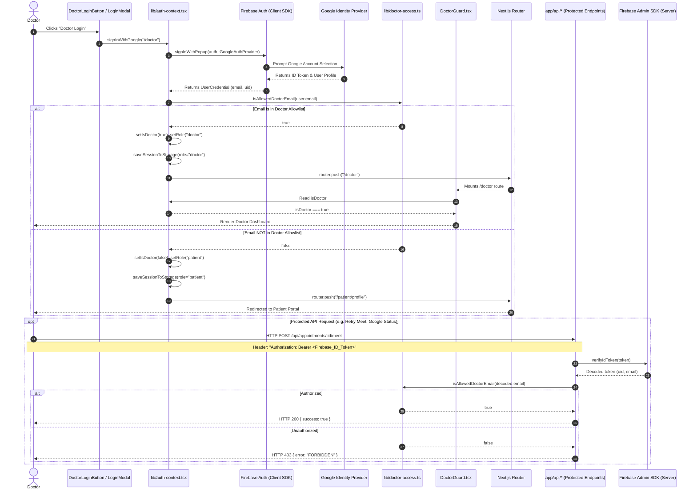
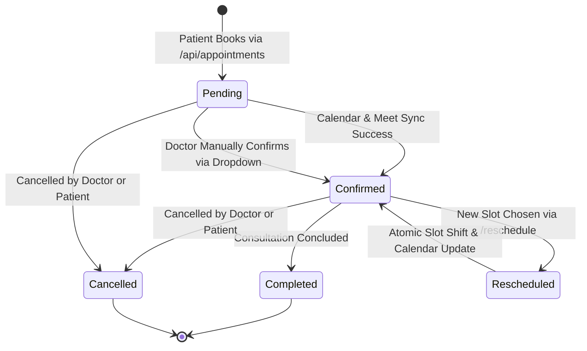
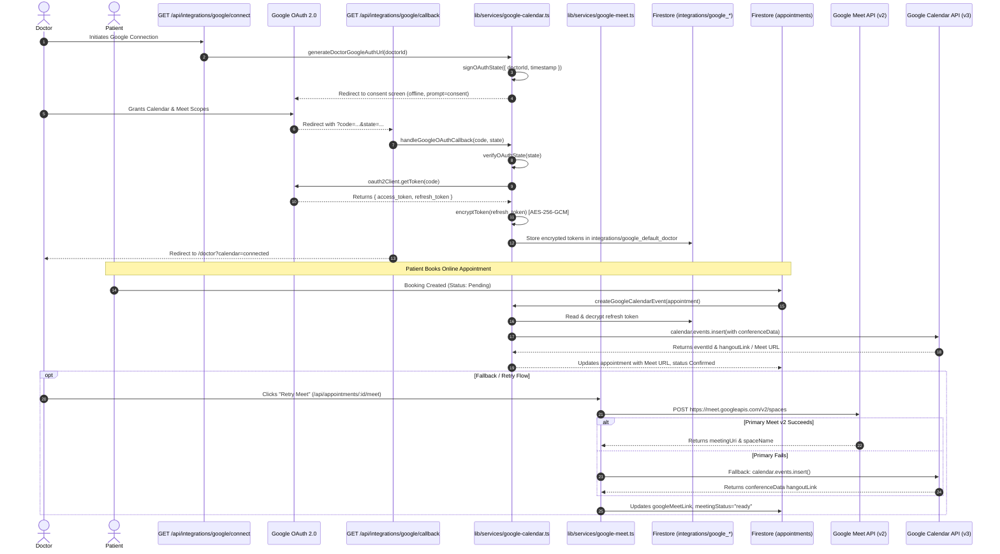
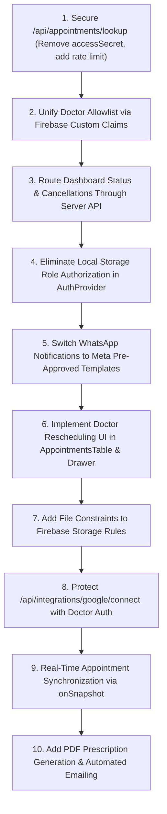
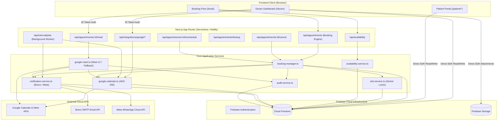

# Comprehensive Technical Audit & Architectural Analysis: Doctor Portal
**Project:** Dr. Pratima Agale Homeopathy Clinic  
**Production URL:** [https://www.pratimaagale.in](https://www.pratimaagale.in)  
**Target Codebase:** `pratima-agale-fresh`  
**Audit Date:** November 14, 2026  
**Auditor Classification:** Senior Software Architect, Security Auditor & Full-Stack Specialist  
**Investigation Mode:** Read-Only Source Code Analysis (Zero Modifications Applied)

---

## 1. Executive Summary

This report presents an exhaustive, source-code-verified investigation of the **Doctor Portal** and clinical management systems in the `pratima-agale-fresh` application. The audit encompasses frontend architecture, Google OAuth integration, Google Meet automation, appointment lifecycle management, patient electronic health records (EHR), prescription formulation, availability engines, real-time doctor-patient communication, security posture, and test coverage.

### Key Strengths Identified
1. **Robust Core Google Meet & Calendar Engine:** The server-side integration (`lib/services/google-calendar.ts` and `lib/services/google-meet.ts`) implements AES-256-GCM token encryption, HMAC-SHA256 OAuth state tamper-resistance, an automated two-tier meeting generation cascade (Google Meet v2 REST API `spaces.create` falling back to Google Calendar Conference Data), and an automatic token refresh persistence listener (`oauth2Client.on("tokens", ...)`).
2. **Atomic Booking & Slot Locking:** Online bookings use Firestore transactions (`lib/services/slot-service.ts`) with strict idempotency key checks and 10-minute slot locks (`slotLocks`), preventing race conditions and double bookings during checkout.
3. **Responsive Clinical Workspace:** The doctor interface (`app/doctor/page.tsx`) provides a cohesive tabbed workstation featuring an appointments table, interactive calendar schedule, patient EHR sliding drawer, availability controls, and live chat.

### Primary Architectural & Security Deficiencies
1. **Direct Client Firestore Mutations Bypassing Backend Business Logic:** When the doctor modifies appointment status via the dashboard dropdown (`app/doctor/page.tsx` line 77), it directly calls the Firestore Client SDK `updateDoc()` (`lib/firestore/appointments.ts` line 73). Consequently, selecting **"Cancelled"** does *not* invoke `cancelAppointmentBooking()` (`lib/services/booking-manager.ts`). The slot lock remains locked in `slotLocks`, the Google Calendar event is never deleted, no cancellation reason is captured, and no audit trail entry is logged in `auditLogs`.
2. **Absence of Rescheduling in Doctor Portal:** While a resilient backend reschedule routine exists (`rescheduleAppointmentBooking` in `lib/services/booking-manager.ts` and `POST /api/appointments/[id]/reschedule`), the doctor dashboard contains zero UI controls or API calls to reschedule appointments.
3. **Unauthenticated Public Phone Lookup Endpoint:** `POST /api/appointments/lookup` (`app/api/appointments/lookup/route.ts`) accepts any 10-digit mobile number with no rate limiting, authentication, or token verification, returning the full appointment object including patient name, email, condition, age, consultation type, and internal `accessSecret`.
4. **Hardcoded Role Whitelist Inconsistency:** `firestore.rules` (lines 6–10) strictly hardcodes three specific developer email addresses in an array. If `NEXT_PUBLIC_ALLOWED_DOCTOR_EMAIL` in `.env` is updated to add a new doctor, frontend components may authorize the user, but all direct Firestore client calls will immediately fail with `permission-denied`.
5. **Local Storage Session Role Poisoning:** `lib/auth-context.tsx` (lines 156 and 258) restores `isDoctor` directly from `localStorage.getItem("dr_pratima_user_session")`. A malicious actor can manually alter their local storage role to `"doctor"` to bypass the frontend `DoctorGuard`, exposing dashboard UI tabs and mocked analytics (though backend and Firestore rules prevent data reads).
6. **WhatsApp Cloud Notification Rejection Risk:** Automated notifications dispatched via `sendWhatsAppViaCloud` (`lib/services/notification-service.ts` line 60) and `sendWhatsAppMessage` (`lib/notifications/send-whatsapp.ts` line 1) transmit freeform `text` messages instead of pre-approved Meta WhatsApp templates. Meta's Cloud API rejects freeform text messages sent outside a 24-hour inbound customer care window with error `131047: Re-engagement message`.
7. **Mocked / Hardcoded Dashboard Analytics:** `components/doctor/DoctorAnalytics.tsx` hardcodes the "Remedy Success Rate" KPI at `"94.2%"` (line 129), and displays synthetic mock data when `totalBookings === 0` (lines 95–111).

---

## 2. Doctor Portal Architecture

### 2.1 Bootstrapping and Loading Lifecycle

The doctor portal is mounted under the Next.js 14 App Router layout at [`app/doctor/layout.tsx`](file:///Users/varun/Developer/pratima-agale-fresh/app/doctor/layout.tsx):

```
+-------------------------------------------------------------+
|                     Root Layout (app/layout.tsx)            |
|  Providers: AuthProvider -> AppointmentProvider -> Language |
+-------------------------------------------------------------+
                              |
                              v
+-------------------------------------------------------------+
|             Doctor Layout (app/doctor/layout.tsx)           |
|                Protected by <DoctorGuard>                   |
|                   Renders <DoctorHeader>                    |
+-------------------------------------------------------------+
                              |
                              v
+-------------------------------------------------------------+
|              Doctor Page (app/doctor/page.tsx)              |
|   Loads KPI Widgets, Sync Card, Tab Bar, and Active View    |
+-------------------------------------------------------------+
```

1. **Page Request:** User navigates to `/doctor`.
2. **Metadata Evaluation:** Line 7 of `app/doctor/layout.tsx` enforces `robots: { index: false, follow: false }`, preventing search engine indexation.
3. **Route Guard:** `DoctorGuard` (`components/doctor/DoctorGuard.tsx`) reads `user`, `loading`, and `isDoctor` from `useAuth()`.
   - While `loading === true`, renders `<LoadingState message="Verifying access..." />`.
   - If `!user`, redirects to root `/`.
   - If `user` is present but `isDoctor === false`, renders an access denied view with a sign-out button.
   - If authorized, mounts `{children}`.
4. **Header Rendering:** `DoctorHeader` (`components/doctor/DoctorHeader.tsx`) renders clinic branding, the authenticated doctor's email, and a sign-out button.
5. **Dashboard Initialization:** `app/doctor/page.tsx` executes `loadAppointments()` inside a `useEffect` hook (lines 55–57).

### 2.2 Component Hierarchy & Data Flow

```mermaid
graph TD
    subgraph DoctorLayout["Doctor Layout (app/doctor/layout.tsx)"]
        DG[DoctorGuard] --> DH[DoctorHeader]
        DG --> DP[DoctorDashboardPage (app/doctor/page.tsx)]
    end

    subgraph DashboardModules["Doctor Dashboard Modules"]
        DP --> KPI[KPI Stats Cards]
        DP --> GSync[GoogleCalendarSyncCard]
        DP --> Tabs[Navigation Toolbar]
        
        Tabs --> T1[Tab 1: Appointments]
        Tabs --> T2[Tab 2: Calendar Schedule]
        Tabs --> T3[Tab 3: Clinic Analytics]
        Tabs --> T4[Tab 4: Availability Settings]
        Tabs --> T5[Tab 5: Patient Chats]
        Tabs --> T6[Tab 6: Blog Management]

        T1 --> AF[AppointmentFilters]
        T1 --> AT[AppointmentsTable]
        T2 --> DC[DoctorCalendar]
        T3 --> DA[DoctorAnalytics]
        T4 --> DAv[DoctorAvailability]
        T5 --> DChat[DoctorChat]
        T6 --> DBlog[DoctorBlogPage (/doctor/blog)]

        DP --> PD[PatientDrawer (EHR Sliding Drawer)]
    end

    subgraph DataLayer["Data Layer & Services"]
        AT -.->|Select Row| PD
        DC -.->|Select Event| PD
        AT -->|Client SDK getDocs/updateDoc| FS_Appts[(Firestore: appointments)]
        DAv -->|Client SDK setDoc| FS_Settings[(Firestore: settings/availability)]
        DChat -->|Client SDK onSnapshot| FS_Chat[(Firestore: conversations)]
        GSync -->|HTTP GET/POST + Bearer Token| API_Google[API: /api/integrations/google/*]
        AT -->|Retry Meet: HTTP POST + Bearer Token| API_Meet[API: /api/appointments/:id/meet]
        AT -->|Status Change Notification| API_Notify[API: /api/notify-status]
    end
```

### 2.3 Contexts, Hooks, and State Management

- **`useAuth()` (`lib/auth-context.tsx`):** Exposes `user`, `userProfile`, `isDoctor`, `role`, `loading`, `signInWithGoogle()`, and `signOut()`. Employs Firebase Auth `onAuthStateChanged` combined with local storage session caching.
- **`useRouter()` (`next/navigation`):** Used for client-side navigation between tabs and login redirection.
- **Component State (`app/doctor/page.tsx`):**
  - `appointments: Appointment[]` — Raw list of all clinic bookings fetched from Firestore.
  - `activeTab` — Current dashboard view (`"appointments" | "calendar" | "analytics" | "availability" | "chat" | "blog"`).
  - `search: string`, `statusFilter: AppointmentStatus | "all"`, `sortDirection: "asc" | "desc"` — Filter and sort parameters.
  - `selectedAppointment: Appointment | null` — Currently active appointment loaded into `PatientDrawer`.
  - `updatingId: string | null` — Tracks the appointment ID currently undergoing status update.
  - `notifyMessage: string` — Toast message showing notification dispatch outcome.

### 2.4 Client SDK vs. Admin SDK Boundaries

| Operation | SDK Utilized | Execution Context | Authorization Boundary |
| :--- | :--- | :--- | :--- |
| **Fetch Appointments** | Firebase Client SDK (`getDocs`) | Browser (`lib/firestore/appointments.ts`) | `firestore.rules` (evaluates `isDoctor()`) |
| **Update Status (Dashboard)** | Firebase Client SDK (`updateDoc`) | Browser (`lib/firestore/appointments.ts`) | `firestore.rules` (evaluates `isDoctor()`) |
| **Save Prescription** | Firebase Client SDK (`updateDoc`) | Browser (`lib/firestore/appointments.ts`) | `firestore.rules` (evaluates `isDoctor()`) |
| **Save Availability** | Firebase Client SDK (`setDoc`) | Browser (`lib/firestore/availability.ts`) | `firestore.rules` (evaluates `isDoctor()`) |
| **Real-Time Patient Chat** | Firebase Client SDK (`onSnapshot`, `addDoc`) | Browser (`lib/services/chat-service.ts`) | `firestore.rules` (evaluates `isDoctor()`) |
| **Retry Meet Generation** | Firebase Admin SDK | Server Route (`app/api/appointments/[id]/meet/route.ts`) | `authenticateDoctorRequest()` (ID Token verification) |
| **Google Calendar Status/Disconnect** | Firebase Admin SDK | Server Route (`app/api/integrations/google/*`) | `authenticateDoctorRequest()` (ID Token verification) |
| **Dispatch Notification** | Firebase Admin SDK | Server Route (`app/api/notify-status/route.ts`) | `authenticateDoctorRequest()` (ID Token verification) |
| **Booking Creation** | Firebase Admin SDK | Server Route (`app/api/appointments/route.ts`) | Public guest / patient booking engine |
| **Background Cron Recovery** | Firebase Admin SDK | Server Route (`app/api/internal/jobs/route.ts`) | `verifyWorkerSecret()` / `INTERNAL_WORKER_SECRET` |

---

## 3. Component Inventory

| Component Name | File Path | Responsibilities & UI Features |
| :--- | :--- | :--- |
| `DoctorLayout` | [`app/doctor/layout.tsx`](file:///Users/varun/Developer/pratima-agale-fresh/app/doctor/layout.tsx) | Enforces route-level access control via `DoctorGuard`; injects metadata `robots: noindex, nofollow`; mounts global doctor header. |
| `DoctorGuard` | [`components/doctor/DoctorGuard.tsx`](file:///Users/varun/Developer/pratima-agale-fresh/components/doctor/DoctorGuard.tsx) | Checks authentication state and doctor role; renders loading spinner, redirects unauthenticated users, or displays access-denied card. |
| `DoctorHeader` | [`components/doctor/DoctorHeader.tsx`](file:///Users/varun/Developer/pratima-agale-fresh/components/doctor/DoctorHeader.tsx) | Top application bar displaying clinic dashboard title, authenticated doctor email, and sign-out action. |
| `DoctorDashboardPage` | [`app/doctor/page.tsx`](file:///Users/varun/Developer/pratima-agale-fresh/app/doctor/page.tsx) | Root dashboard state coordinator; fetches appointments, computes summary KPIs, manages tab switching, and controls EHR drawer state. |
| `GoogleCalendarSyncCard` | [`components/doctor/GoogleCalendarSyncCard.tsx`](file:///Users/varun/Developer/pratima-agale-fresh/components/doctor/GoogleCalendarSyncCard.tsx) | Shows Google Calendar and Meet connection status, connected email, sync error alerts, and Connect/Disconnect triggers. |
| `AppointmentFilters` | [`components/doctor/AppointmentFilters.tsx`](file:///Users/varun/Developer/pratima-agale-fresh/components/doctor/AppointmentFilters.tsx) | Search input (patient name, email, phone), status filter dropdown (`All`, `Pending`, `Confirmed`, `Completed`, `Cancelled`, `Failed`), date sort toggle. |
| `AppointmentsTable` | [`components/doctor/AppointmentsTable.tsx`](file:///Users/varun/Developer/pratima-agale-fresh/components/doctor/AppointmentsTable.tsx) | Dual-layout (desktop table + mobile card stack) appointment list. Includes Meet join/copy/retry actions, delivery status icons, and status selector. |
| `StatusSelect` | [`components/doctor/StatusSelect.tsx`](file:///Users/varun/Developer/pratima-agale-fresh/components/doctor/StatusSelect.tsx) | Controlled dropdown select rendering all valid appointment statuses (`Pending`, `Confirmed`, `Completed`, `Cancelled`, `Failed`). |
| `StatusBadge` | [`components/doctor/StatusBadge.tsx`](file:///Users/varun/Developer/pratima-agale-fresh/components/doctor/StatusBadge.tsx) | Visual status chip with semantic color coding (Pending: Amber, Confirmed: Blue, Completed: Green, Cancelled: Red). |
| `DoctorCalendar` | [`components/doctor/DoctorCalendar.tsx`](file:///Users/varun/Developer/pratima-agale-fresh/components/doctor/DoctorCalendar.tsx) | Interactive monthly grid view grouping appointments by date; side panel displays daily schedules and launches the EHR drawer on click. |
| `DoctorAnalytics` | [`components/doctor/DoctorAnalytics.tsx`](file:///Users/varun/Developer/pratima-agale-fresh/components/doctor/DoctorAnalytics.tsx) | Visual clinic metrics: case breakdown by condition categories, age demographic distribution, language breakdown, and KPI cards. |
| `DoctorAvailability` | [`components/doctor/DoctorAvailability.tsx`](file:///Users/varun/Developer/pratima-agale-fresh/components/doctor/DoctorAvailability.tsx) | Day-of-week active selector (Sun–Sat) and daily consultation time-slot manager with instant addition, deletion, and Firestore sync. |
| `DoctorChat` | [`components/doctor/DoctorChat.tsx`](file:///Users/varun/Developer/pratima-agale-fresh/components/doctor/DoctorChat.tsx) | Two-pane real-time communication workstation: conversation list on left, active message thread, file attachments, and quick EHR profile on right. |
| `PatientDrawer` | [`components/doctor/PatientDrawer.tsx`](file:///Users/varun/Developer/pratima-agale-fresh/components/doctor/PatientDrawer.tsx) | 3-tab sliding EHR drawer: Case Details (clinical modalities, allergies, diagnostic records), Prescription Builder, and History Timeline. |
| `EmptyState` | [`components/doctor/EmptyState.tsx`](file:///Users/varun/Developer/pratima-agale-fresh/components/doctor/EmptyState.tsx) | Fallback view when no appointments match active filters. |
| `LoadingState` | [`components/doctor/LoadingState.tsx`](file:///Users/varun/Developer/pratima-agale-fresh/components/doctor/LoadingState.tsx) | Spinner and contextual status label rendered during async fetches. |
| `DoctorLoginButton` | [`components/DoctorLoginButton.tsx`](file:///Users/varun/Developer/pratima-agale-fresh/components/DoctorLoginButton.tsx) | Header login trigger; switches between "Doctor Login" button and "Dashboard" link when authenticated as doctor. |

---

## 4. Authentication and Authorization Flow

### 4.1 Authentication Architecture

Doctor authentication relies on Firebase Authentication using the Google OAuth identity provider (`signInWithPopup`), coupled with an email allowlist check and server-side JWT verification.



### 4.2 Detailed Flow Tracing

1. **Doctor Access Configuration:** Defined in [`lib/doctor-access.ts`](file:///Users/varun/Developer/pratima-agale-fresh/lib/doctor-access.ts):
   ```typescript
   export const DEFAULT_DOCTOR_EMAILS = "varun45j@gmail.com,sardarvarun121@gmail.com,madhurmeetj@gmail.com";
   export const ALLOWED_DOCTOR_EMAIL = process.env.NEXT_PUBLIC_ALLOWED_DOCTOR_EMAIL || DEFAULT_DOCTOR_EMAILS;
   ```
   `isAllowedDoctorEmail(email)` splits the comma-delimited string, trims whitespace, converts to lowercase, and performs an array membership test.

2. **Sign-In Execution:** In `lib/auth-context.tsx` (lines 286–350), `signInWithGoogle()` configures `GoogleAuthProvider` with `prompt: "select_account"`. If the returned email matches `isAllowedDoctorEmail`, `isDoctor` is set to `true`, `role` is set to `"doctor"`, and session details are serialized into `localStorage` under `dr_pratima_user_session`.

3. **Backend API Request Authorization:** In `lib/security/api-auth.ts`, `authenticateDoctorRequest(req)` intercepts protected server requests:
   - Reads the `Authorization` header and ensures it begins with `Bearer `.
   - Calls `getAdminAuth().verifyIdToken(token)` to cryptographically validate the JWT against Google's public keys.
   - Verifies that `decoded.email` exists and passes `isAllowedDoctorEmail(decoded.email)`.
   - Returns `{ uid, email }` on success, or throws an error resulting in HTTP 401 or HTTP 403.

4. **Internal Worker Authentication:** In `lib/security/api-auth.ts` lines 46–61, `verifyWorkerSecret(req)` allows cron tasks or internal recovery scripts to execute if the header matches `Bearer <INTERNAL_WORKER_SECRET>` or if `?secret=<INTERNAL_WORKER_SECRET>` is passed.

---

## 5. Doctor Dashboard Module Breakdown

### 5.1 Dashboard Overview & Analytics
- **Component:** `DoctorAnalytics` ([`components/doctor/DoctorAnalytics.tsx`](file:///Users/varun/Developer/pratima-agale-fresh/components/doctor/DoctorAnalytics.tsx))
- **Data Source:** Props passed from parent `appointments: Appointment[]`.
- **Query/Calculation:** Computes case distributions via `useMemo` (lines 14–92):
  - Categorizes conditions into `"Skin & Dermatological"`, `"Allergies & Respiratory"`, `"Hair & Trichology"`, `"Gastrointestinal"`, `"Joints & Rheumatology"`, `"Migraine & Neurological"`, or `"General Consultation"`.
  - Aggregates age brackets: Pediatric (<13), Youth (13–24), Adult (25–59), Senior (60+).
  - Groups languages (`en`, `hi`, `mr`).
- **Deficiencies:**
  - Line 129 hardcodes `"Remedy Success Rate"` to `"94.2%"` (no actual clinic outcome data is referenced).
  - Lines 95–111 substitute fake placeholder numbers (e.g. Skin: 12, Allergies: 8) when `totalBookings === 0`.

### 5.2 Appointments Table & KPI Cards
- **Component:** `AppointmentsTable` ([`components/doctor/AppointmentsTable.tsx`](file:///Users/varun/Developer/pratima-agale-fresh/components/doctor/AppointmentsTable.tsx)) & KPI widgets in [`app/doctor/page.tsx`](file:///Users/varun/Developer/pratima-agale-fresh/app/doctor/page.tsx) (lines 117–141).
- **Data Source:** `fetchAppointments()` from [`lib/firestore/appointments.ts`](file:///Users/varun/Developer/pratima-agale-fresh/lib/firestore/appointments.ts).
- **Firestore Query:** `query(collection(db, "appointments"), orderBy("createdAt", "desc"))`.
- **KPI Metrics:**
  - Total Bookings: `appointments.length`
  - Pending Reviews: `appointments.filter(a => a.status === 'Pending').length`
  - Confirmed Slots: `appointments.filter(a => a.status === 'Confirmed').length`
  - Completed Cycles: `appointments.filter(a => a.status === 'Completed').length`
  - Cancelled: `appointments.filter(a => a.status === 'Cancelled').length`
- **User Actions:**
  - Click table row / card: opens `PatientDrawer`.
  - Change status select: triggers `handleStatusChange()`.
  - Copy Google Meet link: copies URL to clipboard with visual confirmation checkmark.
  - Join Meet: opens meeting URL in a new tab.
  - Retry Meet: issues `POST /api/appointments/[id]/meet` with Firebase ID token.

### 5.3 Calendar Schedule
- **Component:** `DoctorCalendar` ([`components/doctor/DoctorCalendar.tsx`](file:///Users/varun/Developer/pratima-agale-fresh/components/doctor/DoctorCalendar.tsx))
- **Data Source:** `appointments` array passed as props.
- **Logic:** Builds a 42-cell monthly grid (including previous/next month padding). Groups appointments in memory by `appointmentDate` (`YYYY-MM-DD`). Clicking a date populates a sidebar with the day's schedule; clicking an appointment opens the `PatientDrawer`.

### 5.4 Doctor Availability Configuration
- **Component:** `DoctorAvailability` ([`components/doctor/DoctorAvailability.tsx`](file:///Users/varun/Developer/pratima-agale-fresh/components/doctor/DoctorAvailability.tsx))
- **Data Source:** `fetchAvailabilitySettings()` from [`lib/firestore/availability.ts`](file:///Users/varun/Developer/pratima-agale-fresh/lib/firestore/availability.ts).
- **Firestore Document:** `settings/availability`.
- **Operations:**
  - Working days toggle: updates array of integers (`0` = Sunday ... `6` = Saturday).
  - Slot addition/removal: adds/removes string timestamps (`HH:mm`) and sorts chronologically.
  - Save button: executes `saveAvailabilitySettings({ weeklyDays, slots })` via client SDK `setDoc()`.

### 5.5 Google Calendar Sync Status Card
- **Component:** `GoogleCalendarSyncCard` ([`components/doctor/GoogleCalendarSyncCard.tsx`](file:///Users/varun/Developer/pratima-agale-fresh/components/doctor/GoogleCalendarSyncCard.tsx))
- **Data Source:** `GET /api/integrations/google/status` with `Authorization: Bearer <idToken>`.
- **State Management:** Tracks `connected`, `calendarEmail`, `connectedAt`, and `syncError`.
- **Actions:**
  - Connect: redirects to `/api/integrations/google/connect?email=<doctorEmail>`.
  - Disconnect: prompts confirmation and issues `POST /api/integrations/google/disconnect`.

---

## 6. Appointment Management & Lifecycle

### 6.1 Lifecycle State Machine



### 6.2 Firestore Document Structure: `appointments/{id}`

| Field Name | Type | Description |
| :--- | :--- | :--- |
| `id` | `string` | Document ID generated by Firestore. |
| `patientId` | `string?` | Optional Firebase Auth UID of registered patient. |
| `patientName` | `string` | Patient full name. |
| `patientEmail` | `string` | Patient contact email (used for notifications & calendar invite). |
| `patientPhone` | `string` | Patient contact phone number (10-digit Indian mobile). |
| `doctorId` | `string` | Assigned doctor ID (defaults to `"default_doctor"`). |
| `appointmentDate` | `string` | Appointment date in `YYYY-MM-DD` format. |
| `appointmentTime` | `string` | Appointment start time in `HH:mm` format (IST). |
| `startTimestamp` | `string?` | ISO 8601 UTC timestamp of appointment start. |
| `endTimestamp` | `string?` | ISO 8601 UTC timestamp of appointment end. |
| `timezone` | `string` | Always `"Asia/Kolkata"`. |
| `consultationType` | `string` | `"online"` or `"in-person"`. |
| `status` | `string` | `"Pending"` \| `"Confirmed"` \| `"Completed"` \| `"Cancelled"` \| `"Failed"`. |
| `condition` | `string?` | Primary medical complaint or condition category. |
| `age` | `string?` | Patient age in years. |
| `message` | `string?` | Additional symptom modalities or notes provided during booking. |
| `lang` | `string?` | Communication language preference (`"en"`, `"hi"`, `"mr"`). |
| `googleCalendarEventId` | `string?` | Google Calendar Event ID returned by Google Calendar v3 API. |
| `calendarId` | `string?` | Target Google calendar ID (defaults to `"primary"`). |
| `googleMeetUrl` | `string?` | Video room URL (e.g. `https://meet.google.com/xyz-uvwx-rst`). |
| `googleMeetLink` | `string?` | Canonical video room link alias. |
| `googleMeetSpaceName` | `string?` | Google Meet v2 space resource name (e.g. `spaces/xyz-uvwx-rst`). |
| `meetingStatus` | `string?` | `"pending"` \| `"creating"` \| `"ready"` \| `"failed"` \| `"not_applicable"`. |
| `meetingCreatedAt` | `string?` | Timestamp of video room generation. |
| `meetingCreatedBy` | `string?` | Identity that created room (`"system"`, doctor email, or worker). |
| `meetingError` | `string?` | Error description if meeting generation failed. |
| `calendarSyncStatus` | `string?` | `"pending"` \| `"synced"` \| `"failed"` \| `"not_applicable"`. |
| `calendarError` | `string?` | Detailed error message from Google Calendar API. |
| `prescription` | `map?` | Embedded prescription record (remedy, potency, dosage, instructions). |
| `progressLogs` | `array?` | Array of patient symptom tracking logs (`rating`, `notes`, `loggedAt`). |
| `notificationStatus` | `map?` | Delivery status for email and WhatsApp (`email`, `whatsapp`, timestamps). |
| `accessSecret` | `string?` | 48-character cryptographic token for patient self-service operations. |
| `idempotencyKey` | `string?` | Unique client request key preventing duplicate bookings. |
| `cancellationReason` | `string?` | Captured reason when booking is cancelled. |
| `cancelledAt` | `string?` | Timestamp when appointment was cancelled. |
| `cancelledBy` | `string?` | Entity that initiated cancellation (`"patient"` \| `"doctor"` \| `"system"`). |
| `rescheduledFrom` | `string?` | Previous date and time string before rescheduling. |
| `createdAt` | `Timestamp` | Record creation timestamp. |
| `updatedAt` | `Timestamp` | Record modification timestamp. |

### 6.3 Lifecycle Tracing & The "Dashboard Cancellation" Flaw

When an appointment is cancelled via the server endpoint (`POST /api/appointments/[id]/cancel`), `cancelAppointmentBooking()` (`lib/services/booking-manager.ts` lines 210–310) executes a complete workflow:
1. Deletes the lock document in `slotLocks` via `releaseSlotLock()`.
2. Deletes the Google Calendar event via `deleteGoogleCalendarEvent()`.
3. Sets `status: "Cancelled"`, `cancellationReason`, `cancelledAt`, and `cancelledBy` in Firestore.
4. Updates the lookup document in `appointment_lookup`.
5. Enqueues a `booking_cancelled` notification job for Brevo and WhatsApp.
6. Writes an audit entry to `auditLogs`.

**However**, in the Doctor Dashboard UI (`app/doctor/page.tsx` lines 72–112), selecting "Cancelled" in the status dropdown executes `handleStatusChange`:
```typescript
await updateAppointmentStatus(id, status, appt?.patientPhone ?? "");
```
This directly calls the client Firestore SDK (`updateDoc(doc(db, "appointments", id), { status })`).
**Impact:**
- The slot lock in `slotLocks` is **never released**. If a patient tries to re-book that slot, `reserveSlotAtomic()` sees the lock as `status: "confirmed"` and throws `SLOT_ALREADY_BOOKED`!
- The Google Calendar event remains active on the doctor's calendar.
- No cancellation audit entry is recorded in `auditLogs`.
- `cancelledBy` and `cancellationReason` remain blank.

---

## 7. Patient Clinical Drawer / EHR

The sliding drawer component [`components/doctor/PatientDrawer.tsx`](file:///Users/varun/Developer/pratima-agale-fresh/components/doctor/PatientDrawer.tsx) opens whenever an appointment row is clicked.

```
+-------------------------------------------------------------------+
| PatientDrawer Header: Patient Name, ID, Close Button              |
+-------------------------------------------------------------------+
| Tabs: [ Case Details ]  |  [ Prescription Builder ]  | [ History ] |
+-------------------------------------------------------------------+
| TAB 1: Case Details                                               |
| - Mode Banner (Online Meet Link + Join/Copy/Retry OR In-Person)   |
| - Notification Delivery Badges (Email: sent/pending, WA: sent)    |
| - Contact Card (Phone, Email, Direct "Chat with Patient" Link)    |
| - Confidential Medical Dossier (Blood Group, Allergies Alert,     |
|   Current Medications, Chronic Diseases, Surgeries, Lifestyle)    |
| - Diagnostic Records (Uploaded PDFs/Scans with "View" download)   |
| - Demographics: Age, Language Preference                          |
| - Chief Complaint & Patient Message                               |
| - Homeopathic Diagnostic Hint (Static clinical guidance)          |
+-------------------------------------------------------------------+
| TAB 2: Prescription Builder                                       |
| - Remedy Name Input (text)                                        |
| - Potency Dropdown (Q, 6C, 30C, 200C, 1M, 10M, LM1, LM2)          |
| - Duration Input (text) & Dosage / Frequency Input (text)         |
| - Special Instructions Textarea                                   |
| - "Save & Issue Prescription" Button                              |
| - Live Monospace Prescription Text Preview                        |
| - Action Buttons: "Copy Text" & "Send WhatsApp" (wa.me link)      |
+-------------------------------------------------------------------+
| TAB 3: History Timeline                                           |
| - Real-time Progress Rating Logs (submitted by patient 1-10)      |
| - Today's Consultation Details                                    |
| - Chronological Past Consultations & Past Prescriptions           |
+-------------------------------------------------------------------+
```

### Feature-by-Feature Analysis

| EHR Feature | Rendering Component | Data Source & Query | Patient ID Matching | Editable? | Backend Operation | Security & Privacy Check |
| :--- | :--- | :--- | :--- | :--- | :--- | :--- |
| **Consultation Mode & Meet** | `PatientDrawer` lines 304–438 | `appointment.googleMeetLink`, `meetingStatus` | Appointment document ID | Actionable | `POST /api/appointments/:id/meet` on Retry | Protected by doctor ID token on retry |
| **Contact Information** | `PatientDrawer` lines 440–477 | `appointment.patientPhone`, `appointment.patientEmail` | Direct from appointment record | Read-only | None | Accessible only to authenticated doctors |
| **Medical Dossier** | `PatientDrawer` lines 479–586 | `getPatientProfile()` (`users/{uid}`) | Tries `appointment.patientId`, falls back to `getPatientProfileByEmail()` | **Read-only** in drawer | None (patient edits via profile page) | Accessible to doctor via `firestore.rules` |
| **Allergies Alert** | `PatientDrawer` lines 505–515 | `patientProfile.allergies` | `users/{uid}` | Read-only | None | Highlighted with amber warning icon for clinical safety |
| **Diagnostic Records** | `PatientDrawer` lines 588–635 | `getMedicalRecords(uid)` (`users/{uid}/medicalRecords`) | `users/{uid}` | Read-only | Direct Firebase Storage signed/public download URLs | Doctor authorized by `storage.rules` |
| **Chief Complaint** | `PatientDrawer` lines 663–675 | `appointment.condition` | Appointment record | Read-only | None | Stored on appointment document |
| **Prescription Builder** | `PatientDrawer` lines 709–850 | `appointment.prescription` | Appointment record | **Editable** | `saveAppointmentPrescription()` (`updateDoc` on appointment) | Direct client update; lacks server audit log |
| **Patient Progress Logs** | `PatientDrawer` lines 861–883 | `appointment.progressLogs` | Appointment record | Read-only | Appended by patient via patient portal | Verified by `firestore.rules` |
| **Past Consultations** | `PatientDrawer` lines 899–940 | Query `appointments` where `patientEmail == appointment.patientEmail` | Matched on email string | Read-only | None | **Privacy Gap:** Email-only match links across unauthenticated bookings |

---

## 8. Prescription Management

### 8.1 Workflow and Data Structure

1. **Opening the Form:** Doctor opens `PatientDrawer` and selects the `"Prescription Builder"` sub-tab. If a prescription already exists on the appointment, fields pre-populate with existing values.
2. **Form Fields:**
   - `Remedy Name`: Text input (e.g. `Arsenicum Album`).
   - `Potency`: Dropdown selector with homeopathic potencies: `Q (Mother Tincture)`, `6C`, `30C`, `200C`, `1M`, `10M`, `LM1`, `LM2`.
   - `Dosage / Frequency`: Text input (default: `"4 globules, twice daily"`).
   - `Duration`: Text input (default: `"7 days"`).
   - `Special Instructions`: Multiline textarea (default: `"Avoid raw onion, garlic, or strong perfumes 30 minutes before/after taking the remedy."`).
3. **Persistence:** Clicking **"Save & Issue Prescription"** calls `saveAppointmentPrescription(appointment.id, rx)` (`lib/firestore/appointments.ts` lines 85–92):
   ```typescript
   export async function saveAppointmentPrescription(id: string, prescription: Prescription): Promise<void> {
     await updateDoc(doc(db, "appointments", id), { prescription });
   }
   ```
4. **Patient Display:** In the Patient Portal ([`app/patient/dashboard/page.tsx`](file:///Users/varun/Developer/pratima-agale-fresh/app/patient/dashboard/page.tsx) lines 620–757), the prescription is rendered as an official digital prescription slip complete with Dr. Pratima Agale's registration details, patient demographics, dosage, and a **"Print Prescription"** action (`window.print()`).

### 8.2 Prescription Gaps & Limitations
- **No PDF Generation Engine:** Neither server-side nor client-side PDF generation exists. The system relies entirely on browser printing (`window.print()`) or WhatsApp text sharing.
- **No Email Dispatch:** The doctor drawer lacks a "Send via Email" button for prescriptions.
- **WhatsApp via `wa.me` Web Link:** The "Send WhatsApp" button triggers `window.open('https://wa.me/91...?text=...')`, passing plaintext prescription details via query string in the browser, rather than using an official server-mediated WhatsApp Cloud API message.
- **Missing Audit Logging:** Saving a prescription via `saveAppointmentPrescription()` does not write to `auditLogs`.

---

## 9. Google Calendar and Google Meet Integration

### 9.1 Google Integration Architecture



### 9.2 OAuth Scopes & Configuration
Configured in `lib/services/google-calendar.ts` (lines 12–16):
- `https://www.googleapis.com/auth/calendar.events`: Read/write access to Google Calendar events.
- `https://www.googleapis.com/auth/userinfo.email`: Verification of the connecting doctor's email.
- `https://www.googleapis.com/auth/meetings.space.created`: Permission to create Google Meet spaces via Meet REST API.

### 9.3 Token Security
- **Encryption:** `lib/security/encryption.ts` utilizes `aes-256-gcm` with a 12-byte random IV and 16-byte authentication tag.
- **Format:** Tokens are stored in Firestore as `iv:authTag:ciphertext` (base64 encoded).
- **Auto-Refresh Persistence:** `oauth2Client.on("tokens", ...)` in both `google-calendar.ts` and `google-meet.ts` listens for automatic access token renewals and re-encrypts and persists new tokens to `integrations/google_${doctorId}` without requiring re-authentication.

---

## 10. Availability & Scheduling Engine

### 10.1 Availability Calculation Flow

When a patient or doctor queries availability (`GET /api/availability?date=YYYY-MM-DD`), `calculateDateAvailability()` in [`lib/services/availability-service.ts`](file:///Users/varun/Developer/pratima-agale-fresh/lib/services/availability-service.ts) executes:
1. **Format Validation:** Validates `YYYY-MM-DD` regex.
2. **Settings Retrieval:** Reads `settings/availability` (defaults: Mon–Sat, slots 10:00–19:00).
3. **Working Day Check:** Converts date to day of week using Kolkata timezone (`Asia/Kolkata`). If the day is inactive, returns `isWorkingDay: false` and marks all slots as `reason: "day_closed"`.
4. **Slot Lock Check:** Queries `slotLocks` where `date == dateStr`. If `status === "confirmed"`, flags as `"booked"`. If `status === "reserved"` and `expiresAt > now`, flags as `"locked"`.
5. **Appointment Check:** Queries `appointments` where `appointmentDate == dateStr` and `status in ['Confirmed', 'Pending']`. Flags as `"booked"`.
6. **Past Slot Check:** Evaluates `isSlotInPast(dateStr, time)` against the current Kolkata time. If the slot has passed, flags as `reason: "past"`.
7. **Result:** Returns `availableSlotsCount` and evaluated slot list.

### 10.2 Scheduling Limitations
- **No Holiday Management:** No collection or UI exists for clinic holiday closures, vacations, or single-day date blocking.
- **Static Daily Slots:** The slot template applies uniformly to all active weekdays; different hours for different days (e.g. half-day Saturday) are not supported.
- **No Overlap Buffer Configuration:** Appointment slots are fixed at 60-minute increments; configurable consultation durations (e.g. 15 min follow-up vs. 60 min new case) do not exist.

---

## 11. Patient Communication & Messaging

### 11.1 Real-Time Doctor-Patient Chat
- **Architecture:** Client SDK Firestore listeners on `conversations/{convId}` and `conversations/{convId}/messages`.
- **Deterministic ID:** Generated via `getConversationIdForPatient(patientUid)` as `conv_${patientUid}`.
- **Unread Tracking:** Sending a message updates conversation metadata atomically using Firestore `increment(1)` (`unreadDoctorCount` or `unreadPatientCount`). Opening the thread resets the respective unread count to 0.
- **File Attachments:** Uploaded via `uploadChatAttachment()` to Firebase Storage (`chat-attachments/{conversationId}/{filename}`) with a 10MB limit.

### 11.2 Automated Notifications (Email & WhatsApp)
- **Queue Service:** Handled by `notificationJobs` collection via `enqueueNotificationJob()` and `executeNotificationJob()`.
- **Email Channel:** Dispatches transactional HTML emails through Brevo API (`https://api.brevo.com/v3/smtp/email`).
- **WhatsApp Channel:** Dispatches messages via Meta WhatsApp Cloud API (`https://graph.facebook.com/v23.0/${phoneId}/messages`).
- **Deficiency:** As identified in Section 1, WhatsApp notifications send freeform text rather than template messages, leading to rejection by Meta when messaging patients outside active 24-hour windows.

---

## 12. Firestore Collection Inventory

| Collection Name | Purpose | Important Fields | Read Permission | Write Permission | Access Method |
| :--- | :--- | :--- | :--- | :--- | :--- |
| `appointments` | Stores clinical booking records | `patientName`, `patientPhone`, `appointmentDate`, `appointmentTime`, `status`, `googleMeetUrl`, `prescription`, `progressLogs` | Authenticated Doctor OR Patient matching `patientId`/`patientEmail` | Doctor full write; Patient can only append `progressLogs` | Client SDK & Admin SDK |
| `users` | Patient profile dossier | `fullName`, `email`, `phone`, `bloodGroup`, `allergies`, `currentMedications`, `chronicDiseases`, `previousSurgeries` | Authenticated user (`uid == userId`) OR Doctor | User (`uid == userId`) OR Doctor | Client SDK & Admin SDK |
| `users/{uid}/medicalRecords` | Patient diagnostic documents | `title`, `type`, `documentURL`, `recordDate`, `createdAt` | Authenticated user (`uid == userId`) OR Doctor | User (`uid == userId`) OR Doctor | Client SDK |
| `conversations` | Doctor-patient chat threads | `patientId`, `patientName`, `lastMessage`, `unreadDoctorCount`, `unreadPatientCount` | Authenticated Doctor OR Patient (`patientId == uid`) | Doctor OR Patient (`patientId == uid`) | Client SDK |
| `conversations/{id}/messages` | Individual chat messages | `senderId`, `senderRole`, `text`, `attachments`, `read`, `createdAt` | Authenticated Doctor OR Conversation owner | Doctor OR Conversation owner | Client SDK |
| `settings` (`settings/availability`) | Weekly clinic schedule & slots | `weeklyDays`, `slots`, `updatedAt` | **Public read (`true`)** | Authenticated Doctor | Client SDK & Admin SDK |
| `doctorAvailability` | Doctor-specific schedule overrides | `slots`, `weeklyDays`, `doctorId` | **Public read (`true`)** | Authenticated Doctor | Admin SDK & Client SDK |
| `slotLocks` | Atomic slot holds & locks | `doctorId`, `date`, `time`, `appointmentId`, `status`, `expiresAt` | **Public read (`true`)** | Authenticated Doctor (writes handled server-side) | Admin SDK (Client read) |
| `integrations` | Encrypted OAuth tokens | `encryptedRefreshToken`, `encryptedAccessToken`, `calendarId`, `email`, `connected` | Authenticated Doctor | Authenticated Doctor | Admin SDK (Client blocked) |
| `notificationJobs` | Notification dispatch queue | `appointmentId`, `channel`, `type`, `status`, `retryCount`, `nextRetryAt` | Authenticated Doctor | Authenticated Doctor | Admin SDK |
| `auditLogs` | Immutable security audit trail | `action`, `entityType`, `entityId`, `actor`, `details`, `timestamp` | Authenticated Doctor | **Blocked to all clients (`false`)** (Admin SDK only) | Admin SDK |
| `appointment_lookup` | Phone-indexed appointment pointer | `patientName`, `patientPhone`, `appointmentId`, `status` | Authenticated Doctor | Authenticated Doctor | Admin SDK |
| `blogs` | Clinic educational articles | `title`, `slug`, `content`, `published`, `coverImage` | Public if `published == true`, Doctor all | Authenticated Doctor | Client SDK |

---

## 13. Complete API Inventory

| API Route | Method | Purpose | Authentication | Authorization | Collections | Status |
| :--- | :--- | :--- | :--- | :--- | :--- | :--- |
| `/api/appointments` | POST | Creates new appointment booking with transactional slot lock | None (Public) | Public Guest / Patient | `slotLocks`, `appointments`, `appointment_lookup`, `notificationJobs`, `auditLogs` | Operational |
| `/api/appointments/[id]` | GET | Retrieves full appointment details | Optional | Access secret token OR Doctor Bearer ID token; returns sanitized data if public | `appointments` | Operational |
| `/api/appointments/[id]` | PATCH | Modifies appointment fields (status, prescription, notes) | Required | Doctor Bearer ID token verified via `authenticateDoctorRequest()` | `appointments`, `auditLogs` | Operational |
| `/api/appointments/[id]/cancel` | POST | Cancels appointment, releases slot lock, deletes calendar event | Required | Patient access token OR Doctor Bearer ID token | `appointments`, `slotLocks`, `appointment_lookup`, `notificationJobs`, `auditLogs` | Operational |
| `/api/appointments/[id]/reschedule` | POST | Reschedules appointment to new slot atomically | Required | Patient access token OR Doctor Bearer ID token | `appointments`, `slotLocks`, `appointment_lookup`, `notificationJobs`, `auditLogs` | Operational |
| `/api/appointments/[id]/meet` | POST | Generates or retries Google Meet room creation | Required | Doctor Bearer ID token OR Worker secret | `appointments`, `integrations`, `notificationJobs`, `auditLogs` | Operational |
| `/api/appointments/[id]/meet` | GET | Fetches Google Meet join link and meeting status | Required | Patient token/auth OR Doctor Bearer ID token | `appointments` | Operational |
| `/api/appointments/lookup` | POST | Looks up appointment by phone number | **None** | **Unauthenticated (Vulnerability)** | `appointment_lookup`, `appointments` | Security Risk |
| `/api/availability` | GET | Calculates slot availability for a given date | None (Public) | Public | `settings`, `doctorAvailability`, `slotLocks`, `appointments` | Operational |
| `/api/notify-status` | POST | Dispatches status change email and WhatsApp notification | Required | Doctor Bearer ID token OR Worker secret | None (Calls Brevo & Meta APIs) | Operational |
| `/api/integrations/google/connect` | GET | Generates HMAC-signed OAuth URL and redirects to Google | **None** | Optional email query check only | None | Insecure |
| `/api/integrations/google/callback` | GET | Exchanges code for tokens, encrypts, and stores in Firestore | OAuth State | HMAC signature & 15-min timestamp verification | `integrations`, `auditLogs` | Operational |
| `/api/integrations/google/status` | GET | Returns Google Calendar connection status for doctor | Required | Doctor Bearer ID token verified via `authenticateDoctorRequest()` | `integrations` | Operational |
| `/api/integrations/google/disconnect` | POST | Revokes Google token and marks integration disconnected | Required | Doctor Bearer ID token verified via `authenticateDoctorRequest()` | `integrations`, `auditLogs` | Operational |
| `/api/internal/jobs` | POST | Background cron worker processing notification queue & calendar recovery | Required | Worker secret (`Bearer <INTERNAL_WORKER_SECRET>`) OR Doctor Bearer ID token | `notificationJobs`, `appointments` | Operational |
| `/api/consult-ai` | POST | AI symptom intake assistant via Groq API cascade | None (Public) | Public | None | Operational |
| `/api/whatsapp/flow-endpoint` | POST | Decrypts and processes Meta WhatsApp Native Flow bookings | Meta Crypto | RSA-OAEP + AES-128-GCM signature validation | `settings`, `appointments` | Operational |
| `/api/integrations/whatsapp/webhook` | GET/POST | Meta Webhook verification handshake and delivery status processor | Meta HMAC | `hub.verify_token` check on GET; `x-hub-signature-256` on POST | `appointments` | Operational |

---

## 14. Security Audit & Vulnerability Assessment

### Severity Findings Matrix

| Finding ID | Title | Severity | Impact |
| :--- | :--- | :--- | :--- |
| **SEC-01** | Unauthenticated Phone Appointment Lookup Leaks Patient PII & Access Secret | **CRITICAL** | Data Privacy Violation / IDOR |
| **SEC-02** | Hardcoded Email Allowlist Mismatch in `firestore.rules` vs. Environment | **CRITICAL** | Authorization Failure / System Breakage |
| **SEC-03** | Client-Side Role Tampering via Local Storage Session Injection | **HIGH** | Broken Access Control / UI Shell Hijack |
| **SEC-04** | Dashboard Status Cancellation Bypasses Slot Release & Calendar Deletion | **HIGH** | Resource Denial / Calendar Inconsistency |
| **SEC-05** | Missing Authentication on Google OAuth Connect Route | **HIGH** | CSRF / Account Linking Abuse |
| **SEC-06** | WhatsApp Freeform Text Rejection Outside 24-Hour Messaging Window | **HIGH** | Communication Failure |
| **SEC-07** | Missing Server Audit Logging on Direct Client Prescription & Status Writes | **HIGH** | Compliance / Audit Trail Failure |
| **SEC-08** | Firebase Storage Rules Lack File Size & MIME-Type Constraints | **MEDIUM** | Unrestricted Storage Consumption |
| **SEC-09** | Webhook Signature Verification Bypass When `APP_SECRET` Unset | **MEDIUM** | Spoofed Webhook Events |
| **SEC-10** | Hardcoded Developer Email Fallback in Production Code | **MEDIUM** | Hardcoded Credentials / Information Exposure |
| **SEC-11** | Mocked Clinic Outcome Statistics Displayed in Analytics | **INFORMATIONAL**| Misleading Clinical Reporting |

---

### Detailed Findings & Proof of Concept

#### SEC-01: Unauthenticated Phone Appointment Lookup Leaks Patient PII & Access Secret
- **Affected Route:** `POST /api/appointments/lookup` ([`app/api/appointments/lookup/route.ts`](file:///Users/varun/Developer/pratima-agale-fresh/app/api/appointments/lookup/route.ts) lines 13–75)
- **Vulnerability:** The endpoint accepts a raw phone number in JSON payload and immediately queries `appointment_lookup` and `appointments` without requiring an authenticated session, OTP challenge, or rate limiting.
- **Data Exposed:** Lines 61–69 return `normalizeAppointment(...)` containing full patient name, email, phone, age, condition, consultation type, Google Meet URL, and crucially, the **`accessSecret`**.
- **Attack Scenario:** An attacker scripts a loop testing Indian mobile number ranges (`+91 98XXXXXXXX`). For each match, the attacker extracts the patient's identity, medical condition, and `accessSecret`. Using the `accessSecret`, the attacker can cancel or reschedule the patient's appointment via `POST /api/appointments/[id]/cancel`.
- **Remediation:** Remove the return of `accessSecret` from public lookup responses. Require OTP verification via SMS/WhatsApp or restrict appointment lookup to authenticated patient sessions. Implement IP-based rate limiting (e.g. 5 requests per 15 minutes via `@upstash/ratelimit`).

#### SEC-02: Hardcoded Email Allowlist Mismatch in `firestore.rules`
- **Affected Files:** [`firestore.rules`](file:///Users/varun/Developer/pratima-agale-fresh/firestore.rules) lines 6–10 vs. [`lib/doctor-access.ts`](file:///Users/varun/Developer/pratima-agale-fresh/lib/doctor-access.ts) lines 1–10.
- **Vulnerability:** `firestore.rules` hardcodes:
  ```
  function isDoctor() {
    return request.auth != null && request.auth.token.email in [
      'varun45j@gmail.com',
      'sardarvarun121@gmail.com',
      'madhurmeetj@gmail.com'
    ];
  }
  ```
  In contrast, application code reads from `process.env.NEXT_PUBLIC_ALLOWED_DOCTOR_EMAIL`.
- **Failure Scenario:** If clinic administrators add a new doctor's email (e.g. `dr.pratima@gmail.com`) to the environment variable, the doctor successfully passes `DoctorGuard` and backend API checks. However, all direct client queries to `appointments`, `settings`, `conversations`, and `users` will be blocked by Firestore with `FirebaseError: Missing or insufficient permissions`, rendering the dashboard entirely broken for that doctor.
- **Remediation:** Adopt Firebase Custom Claims (`admin.auth().setCustomUserClaims(uid, { role: 'doctor' })`) and update rules to `request.auth.token.role == 'doctor'`, or deploy updated rules whenever doctor access changes.

#### SEC-03: Client-Side Role Tampering via Local Storage Session Injection
- **Affected File:** [`lib/auth-context.tsx`](file:///Users/varun/Developer/pratima-agale-fresh/lib/auth-context.tsx) lines 138–174 and 241–274.
- **Vulnerability:** On mount, `AuthProvider` reads `localStorage.getItem("dr_pratima_user_session")`. If present, it executes:
  ```typescript
  setIsDoctor(parsed.role === "doctor");
  setRole(parsed.role || "patient");
  ```
- **Exploitation Scenario:** A visitor opens browser DevTools and executes:
  ```javascript
  localStorage.setItem("dr_pratima_user_session", JSON.stringify({ uid: "attacker", role: "doctor" }));
  window.location.href = "/doctor";
  ```
  `DoctorGuard` evaluates `isDoctor === true` and renders the entire doctor workspace.
- **Remediation:** Never restore authorization claims or the `isDoctor` flag from unverified local storage. `isDoctor` must strictly be derived from `onAuthStateChanged` after verifying `firebaseUser.email` against verified server claims or doctor allowlist.

#### SEC-04: Dashboard Status Cancellation Bypasses Slot Release & Calendar Deletion
- **Affected Files:** [`app/doctor/page.tsx`](file:///Users/varun/Developer/pratima-agale-fresh/app/doctor/page.tsx) lines 72–112, [`lib/firestore/appointments.ts`](file:///Users/varun/Developer/pratima-agale-fresh/lib/firestore/appointments.ts) lines 68–77.
- **Vulnerability:** Changing status to "Cancelled" in the doctor table dropdown calls `updateAppointmentStatus(id, "Cancelled")` directly on Firestore. It never invokes `POST /api/appointments/[id]/cancel`.
- **Impact:** The corresponding `slotLocks` document remains with `status: "confirmed"`. Prospective patients attempting to book that freed time slot receive `SLOT_ALREADY_BOOKED`. The Google Calendar event remains on the doctor's calendar.
- **Remediation:** Refactor `handleStatusChange` in `app/doctor/page.tsx`: when `status === "Cancelled"`, call `POST /api/appointments/${id}/cancel` with doctor auth headers; when `status === "Confirmed"` or other statuses, issue `PATCH /api/appointments/${id}` so all server hooks, calendar updates, and audit logs execute consistently.

#### SEC-05: Missing Authentication on Google OAuth Connect Route
- **Affected File:** [`app/api/integrations/google/connect/route.ts`](file:///Users/varun/Developer/pratima-agale-fresh/app/api/integrations/google/connect/route.ts) lines 7–28.
- **Vulnerability:** `GET /api/integrations/google/connect` does not require a Firebase ID token or session cookie. It accepts optional `doctorId` and `email` query parameters. If no email is provided, it proceeds unconditionally and redirects to Google.
- **Impact:** An unauthenticated user could trigger the connection flow or craft a phishing URL attempting to link an arbitrary Google account to `google_default_doctor`.
- **Remediation:** Require doctor authentication via Bearer token or session cookie before initiating the Google OAuth consent redirect.

---

## 15. Error Handling and Edge Cases

| Scenario | System Behavior (Observed in Code) | Risk / User Experience |
| :--- | :--- | :--- |
| **Firebase Service Unavailable** | Firestore client calls throw exceptions; caught in `try/catch` in `page.tsx`, displaying inline error string. | User sees static error message; no offline fallback caching. |
| **Doctor Session Expires** | Firebase Auth token expires; `auth.currentUser.getIdToken()` auto-refreshes if refresh token is valid. If expired, `authenticateDoctorRequest` rejects API calls with 401. | Doctor receives alert dialogs ("UNAUTHORIZED"); requires re-login. |
| **Google Disconnected** | `getDoctorCalendarClient()` throws `NO_INTEGRATION` or `INTEGRATION_DISCONNECTED`. Booking continues, appointment marked `meetingStatus: "failed"`, `calendarSyncStatus: "failed"`. | Booking succeeds; doctor must click "Retry Meet" after reconnecting. |
| **Meet Creation Fails** | Primary Google Meet v2 API fails; falls back to Calendar conference creation. If both fail, records `meetingStatus: "failed"` and surfaces yellow "Retry" button. | Handled gracefully without crashing the booking or dashboard. |
| **Duplicate Booking Attempt** | `reserveSlotAtomic()` checks `idempotencyKey` before creating documents. If matching key exists, returns existing appointment with `isDuplicate: true`. | Successfully prevents duplicate charges or appointments. |
| **Simultaneous Booking Race** | Two patients submit identical slot at same millisecond; Firestore transaction reads `slotLocks` doc. First transaction writes lock; second encounters `SLOT_ALREADY_BOOKED` and rolls back. | Fully protected against double booking. |
| **Patient Has No Medical History** | `PatientDrawer` lines 581–585 display italicized placeholder: *"Patient has not created a detailed medical profile yet. Basic appointment details only."* | Handled gracefully in UI. |
| **Prescription Save Failure** | Error caught in `try/catch` and logged to console; `savingPrescription` resets to `false`. | No visible error notification displayed to the doctor if save fails. |
| **Brevo Email API Fails** | `sendEmailWithBrevo()` logs error; background job worker records `status: "failed"` and applies exponential backoff (2 min, 8 min, 32 min) up to 3 retries. | Resilient delivery queue architecture. |

---

## 16. Existing Test Coverage

### 16.1 Test Execution Results

The test suite was executed via `npm test` (`node --test tests/*.test.ts`). Output confirmed **90 tests passing across 7 test suites with 0 failures**:

```
ℹ tests 90
ℹ suites 3
ℹ pass 90
ℹ fail 0
ℹ cancelled 0
ℹ skipped 0
ℹ todo 0
ℹ duration_ms 774.568083
```

### 16.2 Test Suite Breakdown

1. **`tests/enterprise-chatbot.test.ts` (25 tests):** Validates NLP intent detection, symptom extraction, Devanagari script preservation (Hindi/Marathi), and emergency override rules.
2. **`tests/giphy-reaction.test.ts` (30+ tests):** Validates contextual GIF detection and suppression of illness reactions on negated symptoms ("I don't have fever").
3. **`tests/google-meet.test.ts` (6 tests):** Validates `normalizeAppointment` Google Meet field preservation, in-clinic defaults, WhatsApp confirmation formatting, and email CTA links.
4. **`tests/integration-logic.test.ts` (5 tests):** Tests `buildSlotLockId` sanitization, `isAllowedDoctorEmail` whitelist matching, Google Meet payload construction, idempotency detection, and slot race simulation.
5. **`tests/patient-chat.test.ts` (5 tests):** Validates `calculateProfileCompletion` percentage weights, deterministic thread ID generation (`conv_{uid}`), appointment deduplication, and allergy highlights.
6. **`tests/phase0-security.test.ts` (4 tests):** Validates AES-256-GCM token encryption/decryption round-trip, HMAC-SHA256 OAuth state tamper-resistance, doctor whitelist enforcement, and Indian mobile number validation.
7. **`tests/unit.test.ts` (7 tests):** Tests timezone conversions to Asia/Kolkata ISO, past slot detection, Brevo email template rendering, and WhatsApp text templates.

### 16.3 Critical Testing Gaps
- **Zero Component Tests:** No tests exist for `DoctorGuard`, `AppointmentsTable`, `PatientDrawer`, `DoctorAvailability`, or `DoctorCalendar` (no React Testing Library or Playwright tests).
- **Zero API Route Integration Tests:** No tests invoke Next.js route handlers (`/api/appointments/[id]`, `/api/appointments/[id]/cancel`, `/api/notify-status`, etc.) with mock HTTP requests.
- **Zero Firestore Security Rules Tests:** The repository lacks unit tests verifying `firestore.rules` and `storage.rules` against the Firebase Emulator Suite (`@firebase/rules-unit-testing`).
- **Zero Prescription Management Tests:** No automated tests verify prescription creation, schema validation, or persistence integrity.

---

## 17. Missing or Incomplete Features

1. **Doctor Rescheduling Functionality:** As verified in Section 4, the doctor dashboard contains no rescheduling interface. The doctor cannot move an appointment to a new date/time, even though the server-side infrastructure (`rescheduleAppointmentBooking`) is fully implemented.
2. **Prescription PDF Generation & Direct Emailing:** Doctors cannot generate a PDF prescription or email it directly from the EHR drawer.
3. **Clinic Holiday & Exception Calendar:** No mechanism exists for the doctor to block out specific dates (holidays, personal leave) without disabling an entire day of the week globally.
4. **Real-Time Appointments Listener:** The appointments table uses a one-time fetch (`fetchAppointments()`) on mount or manual refresh. When a patient books a new appointment online, it does not appear on the doctor's screen in real time (unlike `DoctorChat`, which correctly uses `onSnapshot`).
5. **Standardized Homeopathic Remedy Database:** Remedy selection is a free-text input rather than an auto-completing pharmacopeia, introducing potential spelling inconsistencies in patient records.

---

## 18. Technical Debt

1. **Direct Client Database Mutations:** Bypassing server APIs for status updates and prescriptions creates split business logic, where server-side hooks (audit logging, Google Calendar deletion, slot release) only run when actions originate from patient self-service endpoints.
2. **Local Storage Session Architecture:** Relying on `dr_pratima_user_session` in `localStorage` creates race conditions with Firebase Auth state and introduces role-spoofing vulnerabilities.
3. **Dual API Routes for WhatsApp:** Two redundant routes exist for WhatsApp webhooks: [`app/api/webhook/route.ts`](file:///Users/varun/Developer/pratima-agale-fresh/app/api/webhook/route.ts) and [`app/api/whatsapp/route.ts`](file:///Users/varun/Developer/pratima-agale-fresh/app/api/whatsapp/route.ts) (the latter containing only a stub `// TODO: Handle WhatsApp webhook logic here`).
4. **Hardcoded UI Analytics:** Static fallback numbers and hardcoded percentages in `DoctorAnalytics.tsx` diminish the clinical utility of the analytics module.

---

## 19. Recommended Improvements & Fixes

### Top 10 Prioritized Recommendations



1. **Secure `POST /api/appointments/lookup` (P0 - Immediate):**
   - Strip `accessSecret` and detailed clinical notes from public lookup responses.
   - Enforce IP-based rate limiting (5 req/15 min).
   - Require patient SMS/WhatsApp OTP verification before exposing full appointment data.
2. **Harmonize Doctor Allowlist via Firebase Custom Claims (P0 - Immediate):**
   - Eliminate hardcoded email arrays in `firestore.rules`.
   - Assign `{ role: 'doctor' }` custom claims using Firebase Admin SDK.
   - Update Firestore rules to `request.auth.token.role == 'doctor'`.
3. **Route Dashboard Status Changes Through Server APIs (P0 - Immediate):**
   - Modify `handleStatusChange` in `app/doctor/page.tsx` to call `POST /api/appointments/[id]/cancel` on cancellation, and `PATCH /api/appointments/[id]` on other status updates.
   - Ensure slot locks are released, Google Calendar events are cancelled, and audit logs are recorded.
4. **Eliminate Local Storage Role Authorization (P0 - Immediate):**
   - Remove `setIsDoctor(parsed.role === "doctor")` from `localStorage` restoration in `lib/auth-context.tsx`.
   - Strictly derive `isDoctor` from the verified Firebase Auth user state.
5. **Migrate WhatsApp Notifications to Meta Approved Templates (P1 - High):**
   - Replace freeform `text` messages in `notification-service.ts` with `sendWhatsAppTemplate()` calling verified clinic utility templates (e.g. `appointment_confirmation`, `appointment_cancelled`).
6. **Implement Doctor Reschedule Modal in Portal (P1 - High):**
   - Add a "Reschedule" action in `AppointmentsTable` and `PatientDrawer` that prompts for a new date/time and calls `POST /api/appointments/[id]/reschedule`.
7. **Harden Firebase Storage Rules (P1 - High):**
   - In `storage.rules`, restrict file uploads to `image/*` and `application/pdf`, and enforce `request.resource.size < 15 * 1024 * 1024`.
8. **Authenticate Google OAuth Connect Endpoint (P1 - High):**
   - Require a valid doctor ID token on `GET /api/integrations/google/connect` before generating the OAuth authorization URL.
9. **Upgrade Appointments Table to Real-Time Listener (P2 - Medium):**
   - In `app/doctor/page.tsx`, replace the one-time `fetchAppointments()` with a Firestore `onSnapshot` listener to immediately display incoming bookings.
10. **Implement Native PDF Prescription Generation (P2 - Medium):**
    - Integrate `@react-pdf/renderer` to generate downloadable clinic letterhead prescriptions with doctor signature and clinic seal.

---

## 20. Prioritized Development Roadmap

### Sprint 1: Security Hardening & Authorization (Days 1–3)
- [ ] Patch `POST /api/appointments/lookup` to remove `accessSecret` and add rate limiting.
- [ ] Remove `isDoctor` restoration from `localStorage` in `lib/auth-context.tsx`.
- [ ] Add Firebase Admin script to assign doctor custom claims and synchronize `firestore.rules`.
- [ ] Protect `GET /api/integrations/google/connect` with doctor token verification.
- [ ] Enforce size and MIME restrictions in `storage.rules`.

### Sprint 2: Clinical Workflow & Lifecycle Fixes (Days 4–7)
- [ ] Refactor `handleStatusChange` in `app/doctor/page.tsx` to invoke `POST /api/appointments/[id]/cancel` and `PATCH /api/appointments/[id]`.
- [ ] Verify slot lock release and Google Calendar deletion on dashboard cancellation.
- [ ] Build Doctor Reschedule modal in `AppointmentsTable` wired to `POST /api/appointments/[id]/reschedule`.
- [ ] Convert `AppointmentsTable` to real-time `onSnapshot` subscription.

### Sprint 3: Communication & Compliance Upgrades (Days 8–10)
- [ ] Register and approve Meta WhatsApp utility templates (`booking_confirmed`, `booking_cancelled`, `booking_rescheduled`).
- [ ] Wire `sendWhatsAppTemplate` into `executeNotificationJob()`.
- [ ] Add audit logging to `saveAppointmentPrescription()`.
- [ ] Implement PDF prescription generation and patient email dispatch.
- [ ] Replace mocked analytics statistics in `DoctorAnalytics.tsx` with dynamic aggregate calculations.

---

## 21. Architecture & Workflow Diagrams

### Complete System Architecture Diagram



---

*Report compiled and verified against codebase `pratima-agale-fresh` by Senior Software Architect & Security Auditor.*

