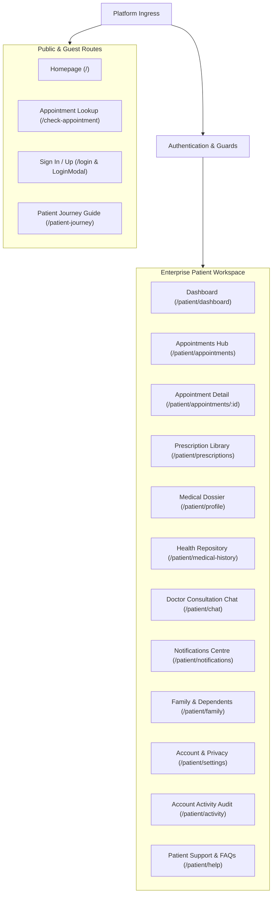
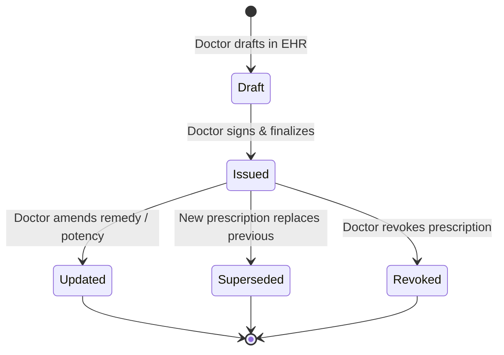
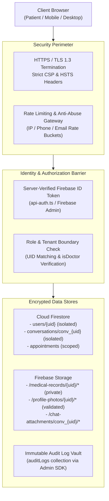
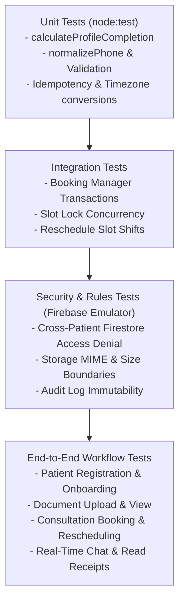
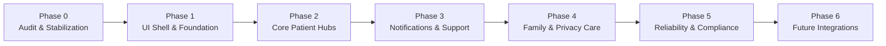

# PRODUCT REQUIREMENTS DOCUMENT v2.0
# Enterprise Patient Experience & Digital Care Platform

**Clinic:** Dr. Pratima Agale Homeopathy Clinic  
**Website:** [https://www.pratimaagale.in](https://www.pratimaagale.in)  
**Product:** Patient Health Portal  
**Application / Repository:** `pratima-agale-fresh`  
**Version:** 2.0 – Enterprise Enhancement  
**Date:** 15 November 2026  
**Status:** Proposed Product Evolution  
**Baseline:** Existing Patient Portal PRD v1.0 and audited implementation

---

### Document Control

| Field | Value |
| :--- | :--- |
| **Product Name** | Enterprise Patient Experience & Digital Care Platform |
| **Application / Repository** | `pratima-agale-fresh` |
| **Primary Route Prefix** | `/patient/*` (`/patient/dashboard`, `/patient/profile`, `/patient/medical-history`, `/patient/chat`, `/patient/appointments`, `/patient/prescriptions`) |
| **Supplementary Routes** | `/check-appointment`, `/login`, `/patient-journey`, `components/LoginModal.tsx` |
| **Target Audience** | Clinic leadership, product managers, software engineers, clinical staff, QA, security auditors |
| **Document Purpose** | Comprehensive functional, architectural, security, and UI/UX specification governing the v2.0 enterprise evolution of the Patient Health Portal |
| **Evidence Boundary** | Grounded in the audited source code of `pratima-agale-fresh` (Next.js 14 App Router, Firebase Auth, Cloud Firestore, Firebase Storage, Next.js API route layer) |
| **Version** | 2.0 / 15 November 2026 |

### Revision Summary
Version 2.0 transitions the Patient Health Portal from a baseline consultation viewer into a full-lifecycle digital healthcare SaaS platform. It formalizes enterprise identity management, dedicated appointment rescheduling and history hubs, structured prescription lifecycle management, a secure medical records repository with authenticated URL delivery, centralized notifications, family/dependent management, symptom progression analytics, and hardened security controls preventing patient data enumeration and cross-tenant access.

---

# 1. Executive Summary

The objective of Version 2.0 is to evolve the existing Patient Health Portal into a comprehensive, secure, and patient-centric digital healthcare platform for Dr. Pratima Agale Homeopathy Clinic.

The existing product baseline provides:
- Patient authentication and account management (Google OAuth, Email/Password, local session fallback).
- Patient dashboard with welcome greeting and profile strength gauge.
- Medical profile and health dossier capturing demographics, allergies, medications, and lifestyle.
- Medical record repository with categorized document uploads.
- Digital prescription viewing modal with clinic credentials and print capability.
- Real-time doctor-patient chat using Cloud Firestore listeners.
- Legacy phone-based appointment lookup and symptom reporting (`/check-appointment`).
- Firebase-based data (`firestore.rules`) and file storage (`storage.rules`).

Version 2.0 elevates these capabilities through enterprise-level user experience, workflow automation, proactive patient engagement, operational reliability, privacy, security, and auditable reporting.

The platform supports patients throughout their complete care journey:

```mermaid
flowchart LR
    Discover["1. Discover\nClinic & Services"] --> Register["2. Register\nVerified Account"]
    Register --> Book["3. Book\nTransactional Slot"]
    Book --> Onboard["4. Onboard\nComplete Dossier"]
    Onboard --> Consult["5. Consult\nOnline Video / In-Clinic"]
    Consult --> Rx["6. Prescription\nDigital Rx & Instructions"]
    Rx --> Monitor["7. Monitor\nSymptom Progress"]
    Monitor --> FollowUp["8. Follow Up\nReschedule / Review"]
    FollowUp --> Records["9. Maintain\nHealth Repository"]
```



The goal is to deliver a premium healthcare SaaS experience that inspires patient confidence and simplifies clinical operations while rigorously preserving existing clinic workflows.

---

# 2. Product Principles

All engineering and design work must adhere strictly to these ten principles:

1. **Patient-First Experience**: Every workflow must reduce anxiety, minimize cognitive load, and provide clear next steps.
2. **Mobile-First Responsive Design**: 70%+ of patients access care via smartphones; interfaces must be optimized for 360px+ screens with touch-friendly 44px targets.
3. **Privacy by Default**: Patient health data (PHI/PII) must be shielded from unauthorized inspection, enumeration, and search engine indexing.
4. **Clinical Information Accuracy & Traceability**: Medical notes, prescriptions, and symptom records must preserve explicit authorship, timestamps, and immutable version trails.
5. **Zero Unauthorized Access (Strict Isolation)**: A patient can never view, mutate, or query another patient's profile, records, appointments, or messages.
6. **Consistent Cross-Module UX**: Unified component patterns, typography, color tokens, and feedback indicators across all routes.
7. **Automated Workflows**: Automate reminders, status updates, slot locks, and unread counters to eliminate manual staff intervention.
8. **Accessible for Diverse Demographics**: Support different age groups and abilities through high-contrast typography, clear labels, keyboard navigation, and multivariant languages.
9. **Resilience Under Slow Networks**: Graceful degradation, offline session recovery, instant local previews, and clear error boundaries for flaky 3G/4G connectivity.
10. **Non-Regression Guarantee**: New enterprise features must be introduced incrementally without breaking or duplicating existing clinical workflows.

---

# 3. Enterprise Information Architecture

The platform preserves established URL paths while introducing dedicated routes for specialized workflows.



## 3.1 Existing Routes to Preserve

| Route | Existing File | Baseline Purpose | v2.0 Enhancement |
| :--- | :--- | :--- | :--- |
| `/patient/dashboard` | `app/patient/dashboard/page.tsx` | Central overview of care, widgets, and recent bookings | Upgrade into actionable workspace with direct actions |
| `/patient/profile` | `app/patient/profile/page.tsx` | Personal details and medical history editor | Section-wise editing, structured clinical schemas, unsaved guards |
| `/patient/medical-history` | `app/patient/medical-history/page.tsx` | Document list and upload modal | Search, date-range filters, secure short-lived URLs, bulk download |
| `/patient/chat` | `app/patient/chat/page.tsx` | 1-on-1 real-time Firestore chat with Dr. Pratima Agale | Message search, attachment progress, reconnection handler |
| `/check-appointment` | `app/check-appointment/page.tsx` | Phone-based status lookup and symptom logger | Add OTP/token rate limiting; prevent phone enumeration |
| `/login` | `app/login/page.tsx` | Dedicated Google/email authentication page | Multi-factor readiness, email verification status notice |

## 3.2 Proposed Additional Routes

| Route | Purpose | Priority | Target Scope |
| :--- | :--- | :---: | :--- |
| `/patient/appointments` | Complete appointment lifecycle management | **P0** | Upcoming, past, and cancelled appointment lists with filters and calendar toggle |
| `/patient/appointments/[id]` | Dedicated appointment detail view | **P0** | Consultation join link, instructions, doctor notes, reschedule/cancel triggers |
| `/patient/prescriptions` | Dedicated prescription library | **P0** | Chronological archive of all issued prescriptions with PDF download and search |
| `/patient/notifications` | Patient notification center | **P1** | In-app feed of booking changes, chat alerts, new prescriptions, and reminders |
| `/patient/family` | Family & dependent care profiles | **P1** | Manage child/elderly dependents with isolated medical histories under one guardian |
| `/patient/settings` | Account, security, and privacy center | **P1** | Password change, notification channel toggles, language, data export request |
| `/patient/activity` | Patient-visible security activity | **P2** | Log of recent logins, profile edits, document downloads, and device sessions |
| `/patient/help` | Help center & clinical FAQs | **P1** | How-to guides for video consults, remedy taking rules, clinic policies, support tickets |

> **Anti-Duplication Rule:** Do not create duplicate components or parallel state stores if an existing service or route already satisfies the workflow. Extend existing modules incrementally.

---

# 4. Enterprise UI/UX Design System

## 4.1 Design Direction & Aesthetics
- **Botanical Clinical Identity**: Deep forest emerald (`#0a3828`), restorative sage (`#4d7c5f`, `#84a98c`), and warm alabaster surfaces (`#fdfbf7`, `#f4f6f0`).
- **Typography**: Cormorant Garamond serif for headings to convey classical medical prestige; Inter / system sans-serif for high-legibility clinical data tables and forms.
- **Visual Restraint**: Clean, minimal cards, 1px subtle borders (`border-sage-200 / border-zinc-800`), 16px–24px rounded corners (`rounded-2xl` / `rounded-3xl`), eliminating gratuitous 3D gradients and noisy animations.
- **Dual Theme Support**: Full semantic light and dark themes utilizing CSS variables (`--bg-base`, `--bg-surface`, `--text-primary`, `--border-color`).

## 4.2 Application Shell (`PatientLayout`)
The layout shell in `app/patient/layout.tsx` is enhanced with:
- **Persistent Clinic Brand Bar**: Dr. Pratima Agale Clinic logo, subtitle, and verified medical registration badge.
- **Desktop Navigation Bar**: Compact horizontal navigation with active route pills, badge counters, and keyboard focus states.
- **Patient Context Header**: Patient avatar, full legal name, active dependent switcher (when dependents exist), notification bell with unread indicator, theme toggle, and secure sign-out.
- **Breadcrumb Navigation**: Dynamic trail (e.g. `Portal > Appointments > Consultation #APPT-842`).
- **Mobile Drawer**: Smooth slide-over navigation with touch-friendly menu items and direct links to main clinic pages.
- **Max Content Constraint**: Centered max-width container (`max-w-7xl mx-auto px-4 sm:px-6 lg:px-8`) preventing wide-screen distortion.

## 4.3 Component Library Matrix

| Component Type | Component Name | Required States |
| :--- | :--- | :--- |
| **Primitives** | `Button`, `IconButton` | Primary, Secondary, Outline, Danger, Loading spinner, Disabled, Active press |
| **Form Controls** | `TextInput`, `TextArea`, `Select`, `PhoneInput`, `DatePicker`, `TimePicker` | Default, Focus ring, Filled, Error state with helper text, Disabled, Read-only |
| **Navigation** | `Breadcrumbs`, `Tabs`, `Pagination`, `StepWizard` | Current, Hover, Inactive, Keyboard navigable |
| **Data Display** | `DataTable`, `StatusBadge`, `StatCard`, `Timeline`, `EmptyState`, `Avatar` | Loading skeleton, Empty data, Error boundary, Responsive mobile card view |
| **Feedback** | `Toast`, `ConfirmationModal`, `AlertBanner`, `ProgressMeter` | Success, Warning, Danger, Info, Auto-dismiss, Undo action |
| **Overlays** | `Drawer`, `ModalDialog`, `DropdownMenu`, `Tooltip` | Esc key close, Backdrop click, Focus trap, Smooth entry/exit transitions |

## 4.4 Responsive Breakpoints & Accessibility
- **Mobile (360px–767px)**: Tables transform into stacked card views; bottom sheets for complex filters; minimum 44px tap targets.
- **Tablet (768px–1023px)**: 2-column dashboard grids; persistent top bar; drawer-based navigation.
- **Desktop (1024px–1439px)**: Full multi-column dashboard; data tables with sortable column headers; inline filter bars.
- **Large Desktop (1440px+)**: Constrained readable widths; multi-pane inspection layouts (e.g. chat thread alongside clinical context).
- **Accessibility Standard**: Compliance with WCAG 2.2 Level AA (4.5:1 text contrast, ARIA landmarks, `aria-expanded` attributes, screen-reader table headers).

---

# 5. Module A – Authentication and Identity Management

**Priority: P0 (Core Foundation)**

## Functional Requirements

### PAT-AUTH-08 – Email Verification
- Enforce email verification for email/password registrations.
- Display an unobtrusive verification banner across the portal until verified.
- Provide a "Resend Verification Email" action with a 60-second cooldown rate limit.
- Prevent unverified accounts from mutating sensitive medical records or initiating real-time chat sessions while permitting read access to existing bookings.
- Gracefully handle expired or invalid action codes.

### PAT-AUTH-09 – Secure Session Architecture
- **Eliminate Unauthenticated Local IDs**: Deprecate trusting `patient_<timestamp>` generated in `localStorage` as proof of patient identity. Protected database and storage operations must require a cryptographically verified Firebase ID token.
- **Token Verification**: Verify Firebase ID tokens server-side in all API routes via Firebase Admin SDK.
- **Session Expiry & Token Refresh**: Handle expired tokens with automatic refresh; if refresh fails, preserve pending form data, clear the session, and prompt re-authentication via modal without losing user context.
- **Global Sign-Out**: `signOut()` must terminate the Firebase Auth session, clear `localStorage` session keys, purge cached memory state, and redirect to the homepage.

### PAT-AUTH-10 – Account Security & Hardening
- **Password Management**: Provide a secure "Change Password" modal requiring verification of the current password before updating.
- **Account Recovery**: Secure password reset flow that never leaks whether an entered email exists in the database (uniform timing and generic success message).
- **Anti-Enumeration & Rate Limiting**: Apply IP and email-based rate limits on sign-in and password reset endpoints (maximum 5 attempts per 15-minute window before exponential backoff).

### PAT-AUTH-11 – Account Lifecycle Governance
- **Profile Completion Gate**: Track completion status; prompt patients to provide essential details (emergency contact, blood group, allergies) before their first consultation.
- **Account Suspension**: Suspended accounts (flagged in Firestore `users/{uid}.status = "suspended"`) are immediately blocked by `PatientGuard` and receive a clear clinical desk contact directive.
- **Data Export Request**: Patients can request an export of their personal health record (demographics, consultation history, prescriptions, uploaded files) in a machine-readable JSON/ZIP package.
- **Retention-Compliant Deletion**: Requests for account deletion must flag the account for administrative review. Personal identity details can be anonymized, but clinical consultation records, audit logs, and issued prescriptions must be retained in accordance with medical-legal record retention obligations.

---

# 6. Module B – Enterprise Patient Dashboard

**Priority: P0 (High-Frequency Experience)**

## 6.1 Welcome & Account Overview
- Personalized greeting utilizing the patient's legal name.
- Profile strength gauge with dynamic completion percentage and one-click link to complete missing fields.
- Verified patient badge and clinic registration reference.

## 6.2 Next Consultation Command Center
Prominently display the next scheduled consultation:
- Scheduled date and time in `Asia/Kolkata` with contextual relative time (e.g. *"Tomorrow at 11:00 AM"*).
- Consultation type badge (`Online Video Consultation` vs `In-Clinic Visit`).
- Assigned clinician: Dr. Pratima Agale (BHMS, MD).
- **Action Triggers**:
  - One-click "Join Video Consultation" (active 15 minutes prior to appointment time).
  - "Reschedule Appointment" button triggering slot selection.
  - "Cancel" button opening policy confirmation dialog.

## 6.3 Verified Treatment & Active Remedy Card
- Displays active remedy only when an authorized prescription exists from an eligible consultation:
  - Remedy name, potency, dosage frequency, and duration.
  - Specific intake instructions and dietary precautions (e.g. *"Avoid coffee, raw garlic, and camphor 30 min before/after remedy"*).
  - Follow-up timeline indicator (e.g. *"Follow-up due in 3 weeks"*).
- **Clinical Integrity Rule**: The dashboard must never fabricate active treatment or guess remedies when no active prescription is on file.

## 6.4 Medical Records Quick Shelf
- Renders the 3 most recently uploaded diagnostic documents with category badges.
- Displays upload date and formatted file size.
- Direct "Upload New Document" button opening the intake modal.
- Link to the full repository at `/patient/medical-history`.

## 6.5 Doctor Messaging Widget
- Live snapshot of the consultation chat thread:
  - Last message preview with sender attribution (`Doctor:` vs `You:`).
  - Unread message count badge.
  - "Open Consultation Chat" button navigating to `/patient/chat`.

## 6.6 Patient Symptom Trend Snapshot
- Visual summary of recent progress logs submitted by the patient.
- 1–10 severity rating trend sparkline.
- Last recorded modality update and timestamp.
- Explicit label: *"Patient-Reported Symptom History (Subject to Clinical Evaluation)"*.

## 6.7 Notification Alert Banner
- Dynamic alert drawer for high-priority items: pending intake forms, confirmed slot shifts, new issued prescriptions, or doctor messages received outside operating hours.

### Dashboard Acceptance Criteria
- Data must be derived entirely from live server records; zero synthetic or hardcoded metrics.
- Comprehensive empty states for newly registered patients with zero bookings.
- Error boundary isolation: A failure in the chat preview widget must not crash the appointment feed or prescription viewer.

---

# 7. Module C – Advanced Appointment Management

**Priority: P0 (Core Clinical Flow)**

## PAT-APPT-01 – Unified Appointment Hub (`/patient/appointments`)
- Dedicated hub listing all patient bookings across life cycle stages:
  - **Upcoming**: Confirmed or Pending appointments scheduled for future dates.
  - **Past / Completed**: Historical consultations with attached prescriptions.
  - **Cancelled**: Terminated bookings with recorded reason and actor.
- Filter by status (`All`, `Confirmed`, `Pending`, `Completed`, `Cancelled`) and date range.
- Toggle between **List View** (detailed metadata cards) and **Calendar View** (monthly visual grid).

## PAT-APPT-02 – Consultation Detail View (`/patient/appointments/[id]`)
- Comprehensive dossier for a single consultation:
  - Booking Reference ID, creation timestamp, and booking source.
  - Confirmed date, time slot, and clinic time zone (`Asia/Kolkata`).
  - Clinician profile and clinic address / Google Meet room URL.
  - Chief complaints provided during intake.
  - Consultation status banner with color-coded badges.
  - Pre-consultation preparation checklist (e.g. quiet room, test camera/mic, have prior reports ready).

## PAT-APPT-03 – Transactional Self-Service Rescheduling
- Patients can reschedule an upcoming appointment directly within the portal:
  1. Patient selects "Reschedule" on eligible appointment (`status in ['Confirmed', 'Pending']`).
  2. System queries live clinician availability (`/api/availability`) excluding booked slots and locks.
  3. Patient chooses a new date and available 60-minute time slot.
  4. Server validates availability transactionally using Firestore transactions.
  5. The previous slot lock is safely released, the appointment document is updated, Google Calendar event is shifted, and notification jobs are dispatched.
  6. Rescheduling history is appended to appointment metadata and logged in the audit trail.

## PAT-APPT-04 – Governed Appointment Cancellation
- Patient selects "Cancel Appointment" and is presented with clinic cancellation terms.
- Captures an optional patient-entered cancellation reason.
- Submits request to server endpoint `/api/appointments/[id]/cancel`.
- Server releases the slot lock, updates appointment status to `Cancelled`, cancels linked calendar events, appends audit record, and triggers cancellation confirmations via email and WhatsApp.

## PAT-APPT-05 – Idempotent Appointment Reminders
- System queues automated reminders:
  - **24-Hour Reminder**: Email and WhatsApp summary with appointment details and Google Meet link.
  - **1-Hour Reminder**: High-priority alert with direct consultation room entry link.
- Every notification job utilizes deterministic idempotency keys (`remind_24h_<apptId>`) to prevent duplicate messages.

## PAT-APPT-06 – Clinic Calendar & Timezone Handling
- All scheduling calculations execute in standard Indian Standard Time (`Asia/Kolkata`, UTC+05:30).
- Automatic handling of daylight saving conversions for international diaspora patients consulting with Dr. Pratima Agale from abroad.

---

# 8. Module D – Patient Profile and Medical Dossier

**Priority: P0 (Clinical Safety & Totality)**

## 8.1 Structured Profile Architecture
The patient dossier in `app/patient/profile/page.tsx` is organized into ten discrete clinical and demographic sections:

```mermaid
flowchart TD
    Dossier["Patient Medical Dossier (UserProfile)"]
    Dossier --> Sec1["1. Demographics & Contacts\n(Name, Phone, DOB, Gender, Address)"]
    Dossier --> Sec2["2. Emergency Contacts\n(Contact Phone, Relationship)"]
    Dossier --> Sec3["3. Biological Markers\n(Blood Group, Vitals)"]
    Dossier --> Sec4["4. Allergies & Hypersensitivities\n(Food, Environmental, Drug)"]
    Dossier --> Sec5["5. Current Medications & Supplements\n(Allopathic, Ayurvedic, Dosages)"]
    Dossier --> Sec6["6. Chronic Pathologies\n(PCOS, Thyroid, Psoriasis, Asthma)"]
    Dossier --> Sec7["7. Surgical History\n(Operations, Procedures, Year)"]
    Dossier --> Sec8["8. Traumatic Injuries\n(Fractures, Head Trauma)"]
    Dossier --> Sec9["9. Present Complaints & History\n(Symptom Onset, Modalities)"]
    Dossier --> Sec10["10. Lifestyle, Diet & Sleep\n(Diet Type, Sleep Hours, Stressors)"]
```



## 8.2 Section-Wise Editing & Form Controls
- **Independent Section Editors**: Allows patients to edit and save specific sections (e.g. updating current medications) without re-submitting the entire dossier.
- **Unsaved Changes Guard**: Browser prompt and modal warning when navigating away from dirty form state.
- **Inline Validation**: Instant feedback for telephone formats (`+91` 10-digit validation), dates of birth (cannot be in future), and email formats.
- **Timestamped Revisions**: Each profile update sets `updatedAt: serverTimestamp()` in Firestore.

## 8.3 Structured Clinical Schema Migration
Transition free-text areas into structured sub-objects to improve clinical searchability:
- **Allergies Schema**:
  ```typescript
  interface AllergyItem {
    id: string;
    allergen: string;
    category: "food" | "environmental" | "medication" | "other";
    reaction: string;
    severity?: "mild" | "moderate" | "severe" | "life_threatening";
    diagnosedDate?: string;
  }
  ```
- **Medications Schema**:
  ```typescript
  interface MedicationItem {
    id: string;
    name: string;
    strength?: string;
    dosage: string;
    purpose?: string;
    startDate?: string;
    isOngoing: boolean;
  }
  ```

## 8.4 Profile Strength Engine (`calculateProfileCompletion`)
- Evaluates completion across 10 vital fields: `fullName`, `email`, `phone`, `dateOfBirth`, `gender`, `address`, `emergencyContact`, `bloodGroup`, `allergies`, `medicalHistory`.
- Renders completion meter (0–100%) with explicit contextual guidance explaining why incomplete sections matter (e.g. *"Adding allergies helps Dr. Pratima choose safe homeopathic potencies"*).
- Sets `profileCompleted: true` when score reaches ≥60%, satisfying clinical onboarding gates.

---

# 9. Module E – Enterprise Medical Records Repository

**Priority: P0 (Diagnostic Integrity)**

## PAT-REC-07 – Advanced Repository Interface (`/patient/medical-history`)
- **Search Engine**: Real-time filtering by document title and doctor notes.
- **Category Filter Tabs**: `All`, `Prescriptions`, `Lab Reports`, `Scans / Imaging`, `Discharge Summaries`, `Other`.
- **Date Range Picker**: Filter records by clinical test date.
- **Display Modes**: Toggle between **Grid Cards** (visual thumbnail layout) and **Data Table** (dense columnar layout for historical review).

## PAT-REC-08 – High-Fidelity Document Preview
- Built-in sandboxed viewer supporting PDF, JPEG, PNG, and WebP.
- Displays metadata: Record title, original file name, formatted file size, test date, upload timestamp, and clinical notes.
- Secure direct download action triggering clean browser file save.

## PAT-REC-09 – Document Processing Lifecycle
Every uploaded file transitions through defined lifecycle states:
- `Uploaded`: File received in client memory; client validations passed.
- `Available`: Upload verified in Firebase Storage and metadata committed to Firestore.
- `Failed`: Network disconnect or MIME validation rejection; retry option rendered.
- `Archived`: Patient-deleted record soft-deleted from view while preserved in backup storage.

## PAT-REC-10 – Secure Document Delivery (Zero Public URLs)
- **Deprecate Public Storage URLs**: Medical records must not be stored with publicly accessible download tokens.
- **Authenticated Link Minting**: The portal must deliver files using short-lived signed URLs (15-minute TTL) generated via Firebase Admin SDK or stream files through an authenticated API endpoint verifying `request.auth.uid == userId`.
- **Storage Boundary**: Enforce `storage.rules` verifying that only the file owner or authorized clinician can read `/medical-records/{userId}/*`.

## PAT-REC-11 – Document Versioning & Audit
- If a patient re-uploads a corrected lab report, the original upload is preserved as a versioned artifact rather than overwritten silently.
- Every file access, download, and deletion is recorded in the clinic audit log.

## PAT-REC-12 – Bulk Operations
- Multi-select capability allowing patients to select multiple lab reports or prescriptions and download a consolidated ZIP package for in-person medical consultations.

---

# 10. Module F – Digital Prescription Centre

**Priority: P0 (Core Clinical Deliverable)**

## 10.1 Dedicated Prescription Hub (`/patient/prescriptions`)
- Centralized chronological archive of all prescriptions issued to the patient across their history.
- Search by remedy name, condition treated, or consultation date.
- Each entry displays issuing clinician, consultation date, chief condition, and prescribed remedy badge.

## 10.2 Prescription Lifecycle State Machine



- **Patient Read-Only Boundary**: Patients can view, search, print, and download `Issued` or `Updated` prescriptions. Patients can never mutate prescription records.
- **Clinician Governance**: Only verified doctor accounts (`isDoctor()`) can issue, update, or revoke prescriptions.

## 10.3 Official Digital Prescription Document Generation
- **Standardized Clinic Letterhead**:
  - Clinic identity: *Dr. Pratima Agale Homeopathic Clinic*.
  - Clinician credentials: *Dr. Pratima Agale, BHMS, MD (Homeopathy)*.
  - Council Registration Number: *Reg No. 56241*.
  - Clinic physical address: *Yogidham Phase 3, Kalyan (W), Mumbai, MH*.
- **Clinical Data Blocks**:
  - Patient legal name, age, gender, consultation ID, and date.
  - Clinical diagnosis and chief condition under care.
  - **Rx Remedy Block**: Remedy name, potency (e.g. *30C, 200CH, 1M, LM*), dosage (e.g. *4 pills twice daily*), and duration.
  - **Homeopathic Instructions**: Detailed intake precautions (clean mouth, avoid strong aromatics like camphor/mint, cool dark storage).
  - Digital verification stamp and clinician signature graphic.
- **Export Capabilities**:
  - One-click print-optimized layout (`@media print` stylesheet removing headers, navbars, and buttons).
  - Server-generated downloadable PDF with verifiable QR code.

---

# 11. Module G – Doctor-Patient Communication

**Priority: P0 (Continuous Care Channel)**

## 11.1 Real-Time Chat Infrastructure (`app/patient/chat/page.tsx`)
- **Deterministic Thread Routing**: Every patient connects to a dedicated conversation document `conversations/conv_{patientUid}` via `getOrCreateConversation`.
- **Low-Latency Streaming**: Firestore `onSnapshot` listener on subcollection `messages` ordered by `createdAt asc`.
- **Delivery & Read States**: Sent (`Check` icon), Read by Doctor (`CheckCheck` in emerald), and Unread message counters.
- **Auto-Read Synchronization**: Opening `/patient/chat` automatically resets `unreadPatientCount: 0`.

## 11.2 PAT-CHAT-08 – Conversation Search
- Search input allowing patients to filter their conversation history by keyword (e.g. searching previous advice on dosage or dietary questions).

## 11.3 PAT-CHAT-09 – Robust Attachment Manager
- Supported formats: JPEG, PNG, WebP images and PDF documents.
- Client-side size validation enforcing 10MB ceiling (`uploadChatAttachment`).
- Interactive pre-upload staging tray with attachment removal chips.
- Inline image lightbox preview and external file open link.
- Reconnection and failed message retry mechanism.

## 11.4 PAT-CHAT-10 – Clinic Availability & Response Times
- Top header informs patients of clinical consultation hours (10:00 AM – 7:00 PM IST).
- Out-of-hours banner setting expectations for non-urgent responses.

## 11.5 PAT-CHAT-11 – Emergency Medical Guard-Rail
- Prominent persistent amber banner at the top of the chat view:  
  > ⚠️ **Emergency Medical Notice:** For acute chest pain, severe breathing difficulty, sudden weakness, or emergency trauma, please call national emergency services (112/108) or visit the nearest emergency hospital immediately. This portal is for non-acute constitutional care.

## 11.6 PAT-CHAT-12 – Cryptographic Privacy Reality & Target
- **Current Baseline**: Firestore security rules restrict message reads/writes strictly to `auth.uid == patientId` and verified doctors. Transport is encrypted via HTTPS/TLS.
- **Enterprise Target**: Introduce application-layer envelope encryption for sensitive chat messages and attachments, with clinician-managed private key decryption.

---

# 12. Module H – Patient Notifications Centre

**Priority: P1 (Engagement & Adherence)**

## 12.1 Notification Hub (`/patient/notifications`)
- Centralized notification feed aggregating clinical and operational events:
  - Appointment confirmations, slot updates, cancellations, and reschedules.
  - New digital prescriptions issued by Dr. Pratima Agale.
  - New incoming doctor chat messages.
  - Scheduled appointment reminders (24-hour and 1-hour notices).
  - Diagnostic document upload status and review notices.
  - Account security notices (password change, new device login).

## 12.2 Multi-Channel Dispatch Architecture
- **In-App Notification Feed**: Stored in `users/{uid}/notifications/{notifId}` with read/unread tracking.
- **Transactional Email**: Branded HTML notifications via Brevo API.
- **Meta WhatsApp Cloud API**: High-priority booking and reminder templates sent to the patient's verified phone.
- **Web Push Notifications (FCM)**: Opt-in browser push notifications when doctor replies in chat while patient is away.

## 12.3 Notification Controls & Reliability
- Mark single notification as read, mark all as read, and filter by unread status.
- Deep links routing patient directly to relevant consultation, prescription, or chat thread.
- Queue decoupling: Notification delivery runs through durable background jobs (`/api/internal/jobs`), ensuring third-party provider failures never abort core booking transactions.

---

# 13. Module I – Family and Dependent Management

**Priority: P1 (Caregiver Enablement)**

## 13.1 Dependent Profiles (`/patient/family`)
Allows primary account holders (parents, adult children) to manage healthcare for dependents:
- Add dependent profile: Legal Name, Date of Birth, Gender, Relationship (`Child`, `Parent`, `Spouse`, `Other`).
- Isolate medical data: Each dependent receives distinct clinical dossier fields, chronic conditions, and uploaded records.
- Associated Bookings: Link appointments to specific dependents (e.g. pediatric consultation for child).
- Guardian Consent: Affirmation of legal guardianship during dependent profile creation.

## 13.2 Access Governance for Dependents
- Strict access controls preventing unauthorized cross-adult record linking. Adult dependents requiring independent access can claim their profile via verified email/phone invitation.
- Complete audit logging of all guardian actions performed on behalf of dependents.

---

# 14. Module J – Symptom and Treatment Progress

**Priority: P1 (Clinical Outcome Tracking)**

## 14.1 Structured Progress Logging
- Evolves the legacy symptom slider from `/check-appointment` into an integrated portal feature:
  - **Symptom Severity Rating**: 1 to 10 scale (1 = Completely Cured, 10 = Very Severe).
  - **Aggravation / Amelioration Modalities**: Structured tags for time of day, temperature, motion, or food influences.
  - **Progress Notes**: Detailed patient description of physical and emotional changes.
  - **Optional Photographic Evidence**: Attach skin condition photos to track dermatological healing (psoriasis, eczema, acne).
  - **Linked Consultation**: Associates update with specific appointment and prescription.

## 14.2 Patient-Reported Longitudinal Charts
- Interactive timeline and symptom intensity graphs visualizing progress over weeks/months.
- **Clinical Governance Guard**: Charts are labeled: *"Patient-Reported Recovery Trend (Informational Only — Evaluated During Clinician Consultations)"*.
- High-severity updates (ratings ≥ 8/10 or reported adverse reactions) trigger an internal alert for Dr. Pratima Agale's review.

---

# 15. Module K – Help and Patient Support

**Priority: P1 (Patient Self-Service)**

## 15.1 Patient Guidance Center (`/patient/help`)
- Interactive FAQ repository covering:
  - How online video consultations work and how to test audio/video before appointments.
  - Comprehensive guide on taking homeopathic remedies (clean mouth, avoiding strong aromatics, proper storage).
  - What to do if initial homeopathic aggravation occurs.
  - How to upload lab reports, scans, and blood tests.
  - Rescheduling, cancellation, and refund policies.
- Direct clinic contact card (WhatsApp, telephone, clinic hours, physical location map).

## 15.2 In-Portal Support Ticketing
- Submit non-clinical administrative inquiries (e.g. billing inquiries, appointment scheduling assistance).
- Tracks ticket status (`Open`, `In Review`, `Resolved`) with staff response history.

---

# 16. Module L – Account Settings and Privacy Centre

**Priority: P1 (Patient Empowerment & Governance)**

## 16.1 Account Controls (`/patient/settings`)
- **Profile & Contact**: Update verified mobile number, email, and residential address.
- **Security**: Update account password with re-authentication step.
- **Notification Preferences**: Granular toggles for email reminders, WhatsApp alerts, and promotional clinic newsletters.
- **Interface Preferences**: Language selection (English, Hindi, Marathi) and theme toggle (Light, Dark, System).

## 16.2 Privacy & Data Governance Center
- Transparent privacy summary explaining how health data is stored, processed, and protected.
- **Export My Health Data**: One-click generation of patient health package (JSON + uploaded attachments).
- **Request Account Deletion**: Formal deletion workflow subject to statutory medical-record retention requirements.

---

# 17. Enterprise Security and Privacy Architecture

**Priority: P0 – Non-Negotiable Release Gate**



## 17.1 Identity Verification & Server-Side Enforcement
- **No Client-Trust Authorization**: Never trust client-provided `uid`, `patientId`, or `role`. Every server route verifies the caller's Firebase ID token via `authenticateDoctorRequest` or patient session token.
- **Custom Claims & Verified Roles**: Establish distinct `role: "patient"` vs `role: "doctor"` verified on backend operations.

## 17.2 Cloud Firestore Hardened Rules (`firestore.rules`)
- **Strict User Sandboxing**: `users/{userId}` and `users/{userId}/medicalRecords/{recordId}` reject any read or write unless `request.auth.uid == userId` or `isDoctor()`.
- **Chat Thread Isolation**: `conversations/{convId}` and `messages/{msgId}` reject traffic unless `convId == 'conv_' + request.auth.uid` or `isDoctor()`.
- **Immutable Audit Events**: The `auditLogs` collection is strictly read-only for doctors and writable solely via backend Firebase Admin SDK (`allow write: if false`).

## 17.3 Secure Document Delivery & Storage Hardening (`storage.rules`)
- **Elimination of Public Medical URLs**: Transition diagnostic file storage from public tokens to authenticated server delivery or short-lived signed URLs (15-minute expiration).
- **MIME & Magic Byte Validation**: Storage rules and server upload handlers validate actual file content (PDF, JPEG, PNG, WebP) and reject executable extensions.
- **Strict Size Ceilings**: Enforce 5MB limit for profile avatars, 10MB limit for chat attachments, and 15MB limit for diagnostic medical records.

## 17.4 Hardening Public Appointment Lookup (`/check-appointment`)
- **Vulnerability Remediation**: Public lookup by phone number alone creates patient enumeration risks.
- **Enterprise Controls**:
  - Implement OTP verification to the registered phone number before returning sensitive consultation details.
  - Strip internal `accessSecret`, patient emails, and private tokens from lookup responses.
  - Enforce strict rate-limiting (max 5 lookup requests per minute per IP).
  - Return uniform generic responses for non-existent numbers to prevent timing attacks.

## 17.5 Comprehensive Audit Trail (`auditLogs`)
- Append-only audit logs recording every critical action:
  - Patient login and failed authentication attempts.
  - Profile dossier updates and allergy modifications.
  - Document uploads, previews, downloads, and deletions.
  - Appointment creations, cancellations, and reschedules.
  - Prescription inspections and prints.
- Audit records store: `eventId`, `actorId`, `actorType`, `action`, `resourceId`, `timestamp`, `ipAddress`, and `outcome`.

## 17.6 Compliance & Legal Alignment
- Comply with applicable provisions of India's **Digital Personal Data Protection Act (DPDPA)**, **DISHA** guidelines, and **Telemedicine Practice Guidelines of India**.
- Explicit patient consent capture during registration for teleconsultations and medical data processing.
- Avoid unsupported claims of compliance without independent qualified legal and security audits.

---

# 18. Enterprise Technical Architecture

## 18.1 Logical Layer Decomposition

```
┌────────────────────────────────────────────────────────────────────────┐
│                        PATIENT FRONTEND (CLIENT)                       │
│  Next.js 14 App Router • React 18 • Tailwind CSS • Lucide Icons       │
│  Routes: /patient/dashboard • /patient/profile • /patient/chat ...     │
└───────────────────────────────────┬────────────────────────────────────┘
                                    │ HTTPS / WSS
┌───────────────────────────────────▼────────────────────────────────────┐
│                    APPLICATION & MIDDLEWARE LAYER                      │
│  PatientGuard • AuthContext • ThemeContext • LanguageContext (EN/HI/MR)│
│  Centralized API Client • Client Data Validation (Zod)                 │
└───────────────────────────────────┬────────────────────────────────────┘
                                    │ REST / Server Actions
┌───────────────────────────────────▼────────────────────────────────────┐
│                 SERVER API & DOMAIN SERVICES LAYER                     │
│  /api/appointments/* • /api/availability • /api/internal/jobs          │
│  booking-manager.ts • slot-service.ts • audit-service.ts               │
│  patient-profile.ts • chat-service.ts • patient-storage.ts             │
└──────────────────┬─────────────────────────────────┬───────────────────┘
                   │ Admin SDK                       │ REST / Webhooks
┌──────────────────▼──────────────────┐ ┌────────────▼───────────────────┐
│          PERSISTENCE LAYER          │ │     EXTERNAL INTEGRATIONS     │
│  Cloud Firestore (EHR, Chats, Appts)│ │  Google Meet / Calendar API    │
│  Firebase Storage (Private Records) │ │  Brevo Email API               │
│  Firebase Auth (Identities, Tokens) │ │  Meta WhatsApp Cloud API       │
└─────────────────────────────────────┘ └───────────────────────────────┘
```

## 18.2 Frontend Architectural Standards
- **Feature Component Colocation**: Modular components isolated under `components/patient/*`.
- **Typed Contracts**: Strict TypeScript interfaces in `lib/types/patient.ts`, `lib/types/appointment.ts`, and `lib/types/chat.ts`.
- **Centralized Error Boundaries**: Every portal page implements an isolated error boundary preventing white-screen crashes.
- **Optimistic UI with Fallbacks**: Local state updates for chat and symptom tracking backed by server reconciliation.

## 18.3 Backend Architectural Standards
- **Stateless Serverless Execution**: Server routes in `/app/api` operate statelessly on Vercel / serverless runtimes.
- **Idempotency Everywhere**: All mutating endpoints accept unique `idempotencyKey` headers to prevent duplicate operations.
- **Graceful Failure Isolation**: External communication failures (Brevo, Meta WhatsApp) do not block core database transactions.

---

# 19. Enterprise Non-Functional Requirements (NFRs)

| Dimension | Enterprise Target | Verification Method |
| :--- | :--- | :--- |
| **Performance (P95)** | Initial Page Load ≤ 2.0s; Subsequent Route Transitions ≤ 500ms; Common API Calls ≤ 600ms | Lighthouse performance audits; Vercel Speed Insights |
| **Availability** | 99.5% monthly uptime for patient portal routes | Uptime monitoring and synthetic ping probes |
| **Mobile Responsiveness** | Flawless rendering from 360px viewport up to 4K desktop displays | Automated viewport visual regression testing |
| **Touch Targets** | Minimum 44px × 44px interactive touch surface | Automated accessibility checks |
| **Accessibility** | Full compliance with WCAG 2.2 Level AA standards | axe-core automated audits and screen-reader testing |
| **Real-Time Latency** | Chat message propagation latency ≤ 800ms | Firestore real-time listener benchmarks |
| **Storage Security** | Zero public URL exposure for medical records; 100% token-authenticated delivery | Security penetration testing |
| **Data Integrity** | Zero double-bookings or concurrent slot collisions | Concurrency stress testing via parallel test runner |
| **Localization** | Trilingual fidelity: English, Hindi (हिन्दी), and Marathi (मराठी) | Translation parity tests across `lib/translations.ts` |

---

# 20. Enterprise Analytics and Product Metrics

Privacy-preserving operational telemetry capturing portal health without exposing identifiable health data (PHI):

| Category | Metric | Definition & Purpose |
| :--- | :--- | :--- |
| **Engagement** | Monthly Active Patients (MAP) | Unique patient accounts accessing the portal in 30 days |
| **Onboarding** | Profile Completion Rate | % of registered patients reaching ≥60% dossier score |
| **Clinical Records** | Document Upload Velocity | Number of diagnostic records uploaded per active patient |
| **Prescriptions** | Prescription Inspection Rate | % of issued prescriptions viewed/printed by patients within 72 hours |
| **Communication** | Chat Engagement & Response | Average patient messages per case; doctor response turnaround time |
| **Operations** | Self-Service Reschedule % | % of reschedules handled independently without clinic staff calls |
| **Attendance** | Patient Consultation Attendance | Confirmed video consult attendance rate vs no-show rate |
| **Reliability** | API Error Rate & Upload Drop % | % of failed API calls, upload timeouts, and chat delivery retries |

---

# 21. Quality Assurance and Testing Strategy

Enterprise release requires comprehensive test coverage executed across unit, integration, security, and component layers.



### Required Test Suites

1. **Authentication Suite**:
   - Google sign-in profile initialization.
   - Email/password validation and error mappings.
   - Password reset email dispatch.
   - Unauthenticated redirection via `PatientGuard`.
2. **Profile & Dossier Suite**:
   - `calculateProfileCompletion` accuracy across partial and full profiles.
   - Stripping privileged fields (`role`, `status`, `uid`) on client update.
   - Photo upload validation (format, size limits).
3. **Medical Records Suite**:
   - File format acceptance (PDF, JPG, PNG, WebP) and rejection of executables.
   - File size ceiling enforcement (15MB).
   - Owner-only access verification; cross-patient read denial.
4. **Appointment Management Suite**:
   - Transactional slot reservation and collision avoidance under concurrent attempts.
   - Reschedule slot swap atomicity.
   - Cancellation slot release and calendar event cleanup.
   - Asia/Kolkata timezone calculations.
5. **Real-Time Communication Suite**:
   - Deterministic thread generation (`conv_{patientUid}`).
   - Bi-directional message streaming and attachment uploads.
   - Unread badge counters and auto-read synchronization.
6. **Security & Vulnerability Suite**:
   - IDOR and cross-patient record access rejection.
   - Phone lookup rate-limiting and anti-enumeration.
   - Sensitive token redaction from API responses.

---

# 22. Release and Implementation Roadmap



### Phase 0 – Audit & Stabilization (Critical Gate)
- Review existing codebase, active routes, and Firestore/Storage security rules.
- Harden public phone lookup against patient enumeration.
- Verify 100% pass rate across baseline test suites (318+ tests).
- **Exit Gate**: All P0 security and data integrity vulnerabilities resolved.

### Phase 1 – Enterprise UI Shell & Design System (P0)
- Enhance `PatientLayout` with persistent header, breadcrumbs, and notification badge.
- Establish responsive component primitives (buttons, inputs, status badges, skeletons).
- Redesign `/patient/dashboard` with actionable cards and empty states.
- **Exit Gate**: Cohesive responsive layout across mobile and desktop without regressions.

### Phase 2 – Core Patient Experience (P0)
- Implement `/patient/appointments` hub with list/calendar modes and rescheduling.
- Implement `/patient/prescriptions` archive with branded print and PDF download.
- Upgrade `/patient/profile` with structured allergy/medication schemas and section-wise editing.
- Upgrade `/patient/medical-history` with search, date filters, and secure URL delivery.
- Upgrade `/patient/chat` with message search and attachment upload progress.
- **Exit Gate**: Core patient care journey operational end-to-end.

### Phase 3 – Communications & Support (P1)
- Implement `/patient/notifications` center with multi-channel dispatch.
- Implement automated 24h and 1h consultation reminders with idempotency.
- Implement `/patient/help` guidance center and support ticket manager.
- Implement enhanced symptom progression logging and longitudinal recovery charts.
- **Exit Gate**: Reliable notification tracking with zero duplicate messages.

### Phase 4 – Advanced Patient Services (P1)
- Implement `/patient/family` for caregiver and dependent management.
- Implement `/patient/settings` and privacy center with health data export.
- Implement `/patient/activity` audit log view for patient security awareness.
- **Exit Gate**: Dependent data isolation and guardian audit trails verified.

### Phase 5 – Enterprise Reliability & Hardening (P0/P1)
- Comprehensive security penetration audit and cross-patient isolation verification.
- Performance optimization ensuring P95 load times ≤ 2.0s.
- Disaster recovery and database backup runbooks tested.
- Full WCAG 2.2 AA accessibility verification.
- **Exit Gate**: All production release gates passed and clinic leadership sign-off recorded.

### Phase 6 – Future National Health Stack Integrations (P2)
- Ayushman Bharat Digital Mission (ABDM) architectural evaluation.
- Ayushman Bharat Health Account (ABHA) ID creation and linking.
- FHIR-compliant electronic health record exchange.
- *Note: Phase 6 features represent future architectural targets and must not be represented as active in current production.*

---

# 23. Prioritization Matrix

| Level | Priority Definition | Modules Included |
| :---: | :--- | :--- |
| **P0** | **Critical Foundation & Safety**<br>Mandatory for safe, secure, and reliable clinical operations | Identity & Sessions (Mod A), Dashboard (Mod B), Appointment Hub (Mod C), Medical Dossier (Mod D), Records Repository (Mod E), Prescription Centre (Mod F), Consultation Chat (Mod G), Security Architecture (Sec 17) |
| **P1** | **Important Enterprise Enhancement**<br>Elevates patient engagement, adherence, and operational scale | Notification Centre (Mod H), Family Care (Mod I), Symptom Progress (Mod J), Patient Support (Mod K), Settings & Privacy (Mod L) |
| **P2** | **Advanced / Future Capability**<br>Strategic integrations and longitudinal analytics | Patient Activity Audit (Mod 3.2), ABDM / ABHA National Health Stack (Phase 6), E2EE Key Management |

---

# 24. Enterprise Definition of Done (DoD)

A feature or module is considered complete and production-ready **only** when all of the following criteria are satisfied:

1. **Existing Workflow Integrity**: Zero regressions in existing booking, consultation, or profile workflows.
2. **Architecture Non-Duplication**: No redundant or duplicate components, API endpoints, or database collections.
3. **Design System Parity**: Pixel-perfect adherence to botanical sage palette, Cormorant Garamond headings, responsive breakpoints (360px+), and dark/light modes.
4. **Explicit State Handling**: Comprehensive rendering of Loading Skeletons, Empty States, Error Boundaries, and Disabled states.
5. **Server-Side Authorization**: Every mutation verified server-side with zero reliance on client-asserted identity or roles.
6. **Patient Data Isolation**: Formally proven that no patient can query, read, or mutate another patient's records or chats.
7. **Storage Privacy**: Zero public medical document URLs; short-lived signed delivery verified.
8. **Anti-Enumeration Active**: Appointment lookup protected by rate-limiting, sanitization, or OTP verification.
9. **Idempotent Operations**: Booking, rescheduling, cancellation, and notification jobs are strictly idempotent.
10. **Traceable Clinical Provenance**: Prescriptions, doctor notes, and records maintain explicit timestamps, clinician identity, and revision trails.
11. **Responsive & Accessible**: Minimum 44px touch targets; WCAG 2.2 Level AA compliance verified.
12. **Automated Test Coverage**: Unit, integration, and security tests pass with 100% success rate (`npm test`).
13. **Clean Production Build**: Next.js production build (`npm run build`) completes without TypeScript or linting errors.
14. **Documented Runbooks**: Operational procedures for backup recovery, staff offboarding, and incident escalation documented.
15. **Clinical & Leadership Sign-Off**: Product owner and clinical lead approval recorded.

---

# 25. Implementation Instructions for Engineering

1. **Anchor on v1.0 Baseline**: Treat the audited implementation and v1.0 PRD as the functional starting point.
2. **Audit Before Modifying**: Inspect existing components in `components/patient/*` and services in `lib/services/*` before authoring new code.
3. **Reuse Established Services**: Utilize `booking-manager.ts`, `slot-service.ts`, `patient-profile.ts`, and `chat-service.ts` rather than reimplementing business logic.
4. **Incremental Staging**: Implement enhancements in small, testable increments mapped to Phases 0 through 5.
5. **Preserve Patient Data**: Ensure all schema additions are backward-compatible; never drop or overwrite existing Firestore fields without tested migration scripts.
6. **Strict Input Sanitization**: Validate all inputs using schema validators (Zod/TypeScript) and sanitize file uploads.
7. **Zero Mock Substitutes**: Never replace working backend services or database queries with mock data in production builds.
8. **Evidence-Based Claims**: Never claim compliance (HIPAA, DISHA, E2EE) or test completion without verifiable test logs and audit artifacts.

---

# Appendix A — Codebase File & Route Traceability Matrix

| Enterprise Requirement | Route / Component | Service / Backend File | Data Store / Rules |
| :--- | :--- | :--- | :--- |
| **Authentication & Sessions** | `/login`, `components/LoginModal.tsx` | `lib/auth-context.tsx`, `lib/auth-errors.ts` | Firebase Auth, `localStorage` |
| **Route Protection** | `components/patient/PatientGuard.tsx` | `lib/auth-context.tsx` | Route middleware / client check |
| **Patient Shell & Nav** | `app/patient/layout.tsx` | `components/patient/PatientAvatar.tsx` | CSS Theme variables |
| **Patient Dashboard** | `app/patient/dashboard/page.tsx` | `lib/services/patient-profile.ts` | Firestore `users`, `appointments` |
| **Appointment Hub** | `/patient/appointments` *(Phase 2)* | `lib/services/booking-manager.ts` | Firestore `appointments` |
| **Appointment Detail** | `/patient/appointments/[id]` *(Phase 2)* | `app/api/appointments/[id]/route.ts` | Firestore `appointments` |
| **Rescheduling Engine** | Appointment modals & detail view | `app/api/appointments/[id]/reschedule/route.ts` | Firestore `slotLocks`, Google Calendar |
| **Cancellation Engine** | Cancel confirmation dialogs | `app/api/appointments/[id]/cancel/route.ts` | `booking-manager.ts`, auditLogs |
| **Medical Dossier** | `app/patient/profile/page.tsx` | `lib/services/patient-profile.ts` | Firestore `users/{uid}` |
| **Avatar Storage** | Profile photo dropzone | `lib/storage/patient-storage.ts` | Storage `profile-photos/{uid}/*` |
| **Document Repository** | `app/patient/medical-history/page.tsx` | `lib/storage/patient-storage.ts` | Storage `medical-records/{uid}/*` |
| **Prescription Library** | `/patient/prescriptions` *(Phase 2)* | `lib/services/patient-profile.ts` | Firestore `appointments.prescription` |
| **Prescription Viewer** | Dashboard modal & print view | `app/patient/dashboard/page.tsx` | Letterhead layout, `@media print` |
| **Doctor Consultation Chat** | `app/patient/chat/page.tsx` | `lib/services/chat-service.ts` | Firestore `conversations/conv_{uid}` |
| **Chat Attachments** | Chat paperclip uploader | `lib/storage/patient-storage.ts` | Storage `chat-attachments/conv_{uid}/*` |
| **Public Phone Lookup** | `app/check-appointment/page.tsx` | `app/api/appointments/lookup/route.ts` | Firestore `appointment_lookup` |
| **Symptom Tracker** | `/check-appointment`, Dashboard widget | `lib/firestore/appointments.ts` | Firestore `appointments.progressLogs` |
| **Notification Jobs** | `/patient/notifications` *(Phase 3)* | `lib/services/notification-service.ts` | Firestore `notificationJobs`, Brevo, WA |
| **Audit Event Logger** | All mutating operations | `lib/services/audit-service.ts` | Firestore `auditLogs` (Admin SDK) |
| **Security Rules** | Database & Storage boundaries | `firestore.rules`, `storage.rules` | Firebase Security Rules compiler |
| **Automated Test Suite** | Test runner (`npm test`) | `tests/patient-chat.test.ts`, `tests/phase0-security.test.ts` | Node.js Test Runner (318 tests) |
