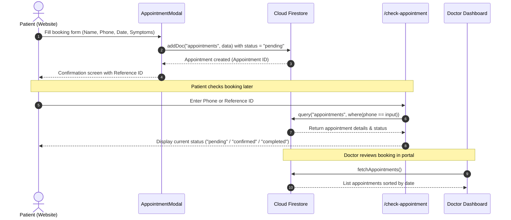
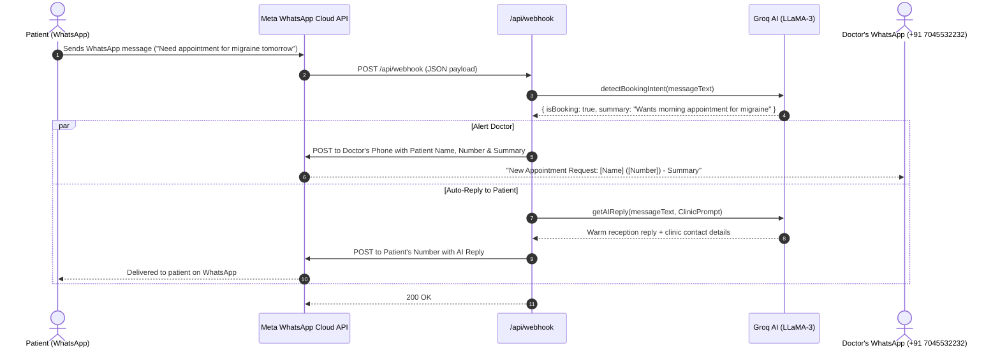
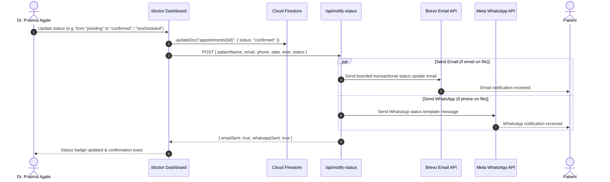

# Project Architecture & Workflow: Dr. Pratima Agale Homeopathy Platform

This document describes the actual architecture, data flows, and subsystem integrations of the current codebase.

---

## 1. End-to-End System Architecture

```mermaid
flowchart TB
    subgraph Users["End Users & Channels"]
        PatientWeb["Patients / Website Visitors\n(Desktop, Mobile, PWA)"]
        PatientWA["Patients on WhatsApp\n(Direct WhatsApp Chat)"]
        Doctor["Dr. Pratima Agale / Staff\n(Admin & Doctor Dashboard)"]
    end

    subgraph Frontend["Next.js 14 App Router (Frontend)"]
        direction TB
        subgraph PublicPages["Public Pages & SEO"]
            Home["Homepage (/)"]
            GeoSEO["Geo SEO Landing Pages\n(/homeopathy-doctor-kalyan, etc.)"]
            DiseasePages["Condition Pages\n(/pcos-treatment-kalyan, /arthritis, etc.)"]
            BlogPages["Blog & Case Studies\n(/blog, /case-studies)"]
            CheckAppt["Appointment Lookup\n(/check-appointment)"]
        end

        subgraph ClientContexts["Client State Providers"]
            LangCtx["LanguageContext\n(EN / HI / MR Translations)"]
            AuthCtx["AuthContext\n(Doctor Login / Firebase Auth)"]
            ThemeCtx["ThemeContext\n(Dark / Light UI)"]
            ApptCtx["AppointmentContext\n(Lookup & Active Booking State)"]
        end

        subgraph InteractiveModals["Interactive Components"]
            ApptModal["AppointmentModal.tsx\n(Booking & Patient Details)"]
            Chatbase["ChatbaseWidget.tsx\n(Site Chat Assistant)"]
            WABtn["WhatsAppButton.tsx\n(Direct WhatsApp Link)"]
        end

        subgraph DoctorPortal["Doctor Management Portal"]
            DoctorDash["Doctor Portal (/doctor)\n(Manage Appointments & Prescriptions)"]
            AdminDash["Admin Portal (/admin)\n(Doctor Accounts & Config)"]
        end
    end

    subgraph BackendAPI["Next.js API Serverless Routes (/app/api)"]
        WAWebhook["/api/webhook\n(Meta Verification & Inbound Messages)"]
        WAFlow["/api/whatsapp/flow-endpoint\n(WhatsApp Flow Forms)"]
        NotifyStatus["/api/notify-status\n(Status Change Trigger)"]
        SendMessage["/api/send-message\n(Direct Outbound Messaging)"]
    end

    subgraph FirebaseServices["Google Firebase Suite (Cloud)"]
        FirebaseAuth["Firebase Authentication\n(Doctor Credentials)"]
        FirestoreDB[("Cloud Firestore\n- appointments\n- doctors\n- blogs\n- availability")]
        FirebaseStorage[("Firebase Cloud Storage\n(Prescriptions & Patient Uploads)")]
        FCM["FCM Push Notifications\n(Staff Device Alerts)"]
    end

    subgraph ExternalIntegrations["Third-Party AI & Communications APIs"]
        GroqAI["Groq Cloud API\n(LLaMA-3 Booking Intent & Auto-replies)"]
        MetaGraph["Meta WhatsApp Cloud API\n(Inbound / Outbound WhatsApp Messages)"]
        Brevo["Brevo API\n(Transactional Status Emails)"]
        ChatbaseSvc["Chatbase AI Cloud"]
    end

    %% User interactions
    PatientWeb --> PublicPages
    PatientWeb --> InteractiveModals
    PatientWA <--> MetaGraph
    Doctor --> DoctorPortal

    %% State wiring
    PublicPages --> ClientContexts
    DoctorPortal --> AuthCtx
    InteractiveModals --> ApptCtx

    %% Frontend to Firebase
    ApptModal -->|Direct Firestore Write| FirestoreDB
    CheckAppt -->|Lookup Appointment| FirestoreDB
    DoctorPortal -->|Read / Update Appointments| FirestoreDB
    DoctorPortal -->|Upload Prescriptions| FirebaseStorage
    AuthCtx <--> FirebaseAuth

    %% Webhook & API flows
    MetaGraph <-->|Webhook Inbound / Outbound| WAWebhook
    MetaGraph <--> WAFlow
    WAWebhook -->|Detect Intent & Generate Reply| GroqAI
    WAWebhook -->|Send Doctor Alert SMS/WA| MetaGraph
    DoctorPortal -->|Trigger Status Notification| NotifyStatus
    DoctorPortal -->|Send Direct Message| SendMessage

    %% Backend to External
    NotifyStatus -->|Send Email| Brevo
    NotifyStatus -->|Send WhatsApp Template| MetaGraph
    SendMessage --> MetaGraph
    Chatbase --> ChatbaseSvc
```

---

## 2. Core User Workflows

### 2.1. Website Appointment Booking & Lookup Flow

---

### 2.2. WhatsApp AI Receptionist & Doctor Alert Flow

---

### 2.3. Doctor Status Update & Patient Notification Flow

---

## 3. Directory Map & Component Responsibilities

| Path | Primary Function | Connected Services |
|---|---|---|
| `app/page.tsx` | Main Homepage with hero, services overview, patient journey, and testimonials | `LanguageContext`, `AppointmentModal` |
| `app/homeopathy-doctor-*` | Programmatic local SEO landing pages (Kalyan, Dombivli, Thane, Mumbai) | Schema.org microdata, Local maps |
| `app/doctor/` | Authenticated Doctor Portal: schedule view, appointment management, prescription writing | `firebase/auth`, `firebase/firestore`, `/api/notify-status` |
| `app/admin/` | Clinic administration portal: doctor user accounts, working hours, and clinic settings | `firebase/firestore` |
| `app/api/webhook/route.ts` | Meta WhatsApp Cloud API webhook: verifies webhook token, parses incoming messages | Meta Graph API v21.0, Groq LLaMA-3 |
| `app/api/notify-status/route.ts` | Multi-channel appointment notifications on status change | Brevo Email API, WhatsApp Cloud API |
| `components/AppointmentModal.tsx` | Patient-facing booking modal with date/time pickers and validation | Direct Firestore client write |
| `lib/translations.ts` | Complete localization dictionary for English, Hindi, and Marathi | `language-context.tsx` |
| `lib/firebase.ts` | Firebase Client SDK initialization (Auth, Firestore, Storage, Analytics) | Firebase Project `doc-web-a913f` |
