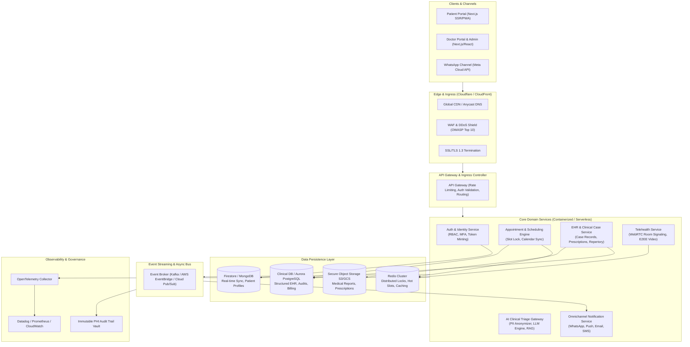
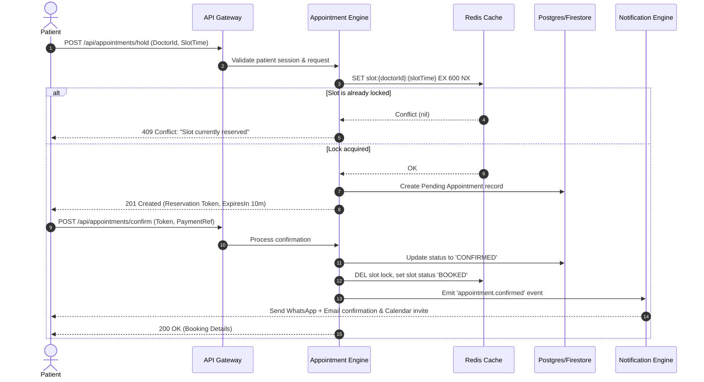
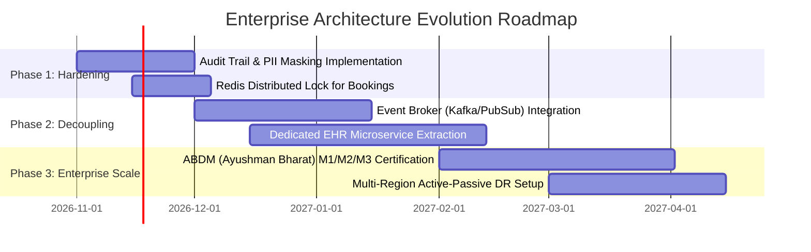

# Enterprise System Architecture: Dr. Pratima Agale Clinical Platform

## 1. Executive Summary & Architecture Principles

The **Dr. Pratima Agale Clinical Platform** is an enterprise-grade digital healthcare and clinical practice management ecosystem. It facilitates omnichannel patient engagement, clinical case management, AI-augmented triage, appointment scheduling, and telemedicine while adhering strictly to healthcare compliance standards (**HIPAA**, **DISHA** in India, and **ABDM**—Ayushman Bharat Digital Mission).

### Core Architectural Principles
* **Zero-Trust Security**: Least privilege access across all services; mutual TLS (mTLS) for inter-service communication; encrypted PHI (Protected Health Information) at rest and in transit.
* **Domain-Driven Modularity**: Distinct boundary contexts for Scheduling, Patient EHR, Telehealth, Communication, and AI Triage.
* **Event-Driven Resilience**: Asynchronous decoupling using message brokers with idempotent handlers and dead-letter queues (DLQ).
* **Strict Concurrency Guarantees**: Distributed locks and atomic reservations to eliminate double-booking and slot collision.
* **Observability-First**: Distributed tracing, metrics (SLIs/SLOs), structured audit trails, and automated alerts.

---

## 2. High-Level System Architecture (HLD)

---

## 3. Subsystem Domain Decomposition

### 3.1. Identity, Access & RBAC Engine
* **Authentication**: Multi-factor authentication (MFA) via SMS/WhatsApp OTP and WebAuthn/Passkeys for doctors.
* **Role-Based Access Control (RBAC)**:
  * `SUPER_ADMIN`: System config, doctor credentialing, audit trail inspection.
  * `DOCTOR`: Clinical notes authoring, prescription signing, medical history review.
  * `CLINIC_STAFF`: Patient check-in, slot schedule override, billing receipts.
  * `PATIENT`: Self-appointment booking, view personal case records and signed prescriptions.
* **Token Standard**: Short-lived JWTs (15 min) with cryptographic asymmetric signing (RS256) and Redis-backed revocation lists.

### 3.2. Appointment & Scheduling Engine
* **Distributed Slot Reservation**:
  * Prevents double-booking during concurrent patient checkouts via **Redis Distributed Locks (Redlock)**.
  * Reservation TTL: 10 minutes temporary hold during intake/payment; automatically released if unpaid.
* **Calendar Engine**: Two-way sync with Google Calendar and Apple iCal via RFC 5545 iCalendar standard.

### 3.3. Clinical EHR & Repertory Engine
* **Longitudinal Patient Record**: Unified timeline recording symptoms, miasmatic evaluations, rubrics, potency progressions, and follow-up observations.
* **Prescription Engine**: Digitally signed prescription PDFs stored in immutable object storage with cryptographic SHA-256 hash validation.
* **Attachment Security**: Reports (blood work, sonography) uploaded via short-lived pre-signed URLs directly to encrypted object storage; no raw files hit application servers.

### 3.4. AI Clinical Assistant & Triage Pipeline
* **Architecture**: Secure proxy gateway wrapping LLM backends (Anthropic Claude 3.5 Sonnet / Google Gemini 1.5 Pro / Groq LLaMA-3).
* **PII Redaction**: Pre-inference regex and Named Entity Recognition (NER) pipeline that scrubs names, addresses, and phone numbers before reaching external LLMs.
* **RAG Engine**: Vector store (pgvector / Pinecone) indexing validated Homeopathic Repertory (Kent, Boericke) to propose symptom rubrics to the clinician.
* **Guardrails**: Hardcoded medical disclaimer injection, red-flag symptom detection (e.g., chest pain, stroke symptoms) which bypasses homeopathic triage and triggers emergency protocols.

---

## 4. Data Persistence & Caching Topology

| Storage Tier | Technology | Purpose | Retention / Disaster Recovery |
|---|---|---|---|
| **Transactional Relational** | Aurora PostgreSQL (Multi-AZ) | Appointments, Audit Logs, Prescriptions, Clinical Master | Continuous WAL archiving, 30-day point-in-time recovery |
| **Document / Real-time** | Cloud Firestore | Live consultation state, Patient chats, Notification tokens | Daily snapshots, Multi-region failover |
| **In-Memory Cache & Lock** | Redis Cluster (AWS ElastiCache / Redis Cloud) | Distributed locks, Session state, API rate-limiting tokens | In-memory with append-only file (AOF) persistence |
| **Object Store** | Amazon S3 / Google Cloud Storage | Medical reports, Lab scans, Signed PDF prescriptions | Versioning enabled, Server-Side Encryption (KMS), Lifecycle policy |
| **Vector DB** | pgvector (integrated into PostgreSQL) | Homeopathic repertory & clinical case semantic search | Backed up with primary relational database |

---

## 5. Security, Privacy & Healthcare Compliance

### 5.1. HIPAA & DISHA Compliance Architecture
* **Encryption Standards**:
  * **Data in Transit**: Forced TLS 1.3 with HSTS (HTTP Strict Transport Security, `max-age=31536000`).
  * **Data at Rest**: AES-256 encryption across all databases, backups, and object storage buckets using AWS KMS / Cloud KMS with customer-managed keys (CMEK) and annual key rotation.
* **Protected Health Information (PHI) Isolation**:
  * Clinical notes and diagnoses stored in encrypted partitions separated from billing and demographic contact info.
* **Non-Repudiation Audit Logs**:
  * Every read, write, export, and delete operation on patient data writes an immutable structured audit log.

---

## 6. High Availability, Scaling & Disaster Recovery (DR)

* **Multi-AZ Architecture**: All stateless application containers run across at least 3 Availability Zones behind an Application Load Balancer.
* **Autoscaling Rules**:
  * Scale out when CPU utilization exceeds 65% or p95 request latency exceeds 350ms.
* **Recovery Metrics**:
  * **RTO (Recovery Time Objective)**: < 15 minutes.
  * **RPO (Recovery Point Objective)**: < 1 minute (via continuous write-ahead log shipping).

---

## 7. Migration & Evolutionary Roadmap

